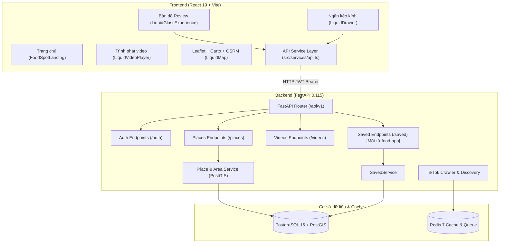

# BÁO CÁO TOÀN DIỆN: ĐÁNH GIÁ KẾT NỐI FRONTEND - BACKEND & PHƯƠNG ÁN GỘP CHỨC NĂNG LƯU TRỮ (FOOD SPOT)

> **Thời điểm lập báo cáo:** 07/11/2026  
> **Công cụ phân tích:** `Graphify Knowledge Graph` + `Codebase Memory MCP` + Trực tiếp rà soát mã nguồn `front` và `backend` trên 2 nhánh `ui/front_web` và `food-app`.

---

## 1. TỔNG QUAN KIẾN TRÚC HỆ THỐNG (SYSTEM OVERVIEW)

Dựa trên kết quả trích xuất từ **Codebase Memory MCP** (580 nodes, 1354 edges) và **Graphify Graph Analysis**:



### Các thực thể cốt lõi (Core Abstractions - "God Nodes"):
1. **`User` (23 liên kết):** Trung tâm xác thực, sở hữu các lượt phân tích (`AnalysisRun`), danh sách địa điểm đã lưu (`SavedPlace`), danh sách video đã lưu (`SavedVideo`).
2. **`Place` (Địa điểm quán ăn):** Chứa tọa độ không gian (lat, lng, PostGIS point), tên quán, địa chỉ, danh mục món ăn, độ tương đồng chuỗi và khoảng cách bán kính.
3. **`Video` (Video review):** Chứa metadata TikTok (platform_video_id, title, thumbnail, view/like count, transcript).
4. **`VideoPlaceMatch` (Cầu nối then chốt):** Bảng quan hệ N-N nối giữa `Video` và `Place` với độ tin cậy `confidence` và bằng chứng trích xuất `evidence`.
5. **`LiquidGlassExperience` & `LiquidMap`:** Bộ điều phối UI chính của Frontend, tích hợp bản đồ Carto Voyager và bộ chỉ đường OSRM.

---

## 2. ĐÁNH GIÁ HIỆN TRẠNG MẮC NỐI (FRONTEND ↔ BACKEND)

### 2.1. Những điểm ĐÃ LÀM TỐT
- **CORS & Môi trường:** Backend `main.py` đã cấu hình mở CORS cho các cổng Vite (`5173`, `127.0.0.1:5173`) và Expo. `docker-compose.yml` có sẵn `VITE_API_BASE_URL=http://localhost:8000`.
- **API Client ở Frontend (src/services/api.ts):** Đã xây dựng đầy đủ các module `authApi`, `placesApi`, `videosApi`, `healthApi`, cơ chế tự động đính kèm `Bearer Token`, parse lỗi HTTP chi tiết.
- **Backend Services phong phú ở nhánh `food-app`:** Đã tích hợp PostGIS tìm kiếm theo bán kính thực (`ST_DWithin`), bộ lọc tiếng Việt không dấu (`unaccent` + `similarity`), và module lưu trữ chuyên biệt `SavedService`.

### 2.2. Những điểm CHƯA TỐT / ĐỨT GÃY (GAPS & DISCONNECTS)

| Hạng mục | Thực trạng Backend | Thực trạng Frontend hiện tại | Đánh giá & Rủi ro |
| :--- | :--- | :--- | :--- |
| **Xác thực (Auth)** | Có JWT đầy đủ (`/auth/login`, `/auth/register`, `/auth/me`). Trả về Bearer Token chuẩn. | `Login.tsx` và `UnifiedHeader.tsx` **vẫn dùng `mockAuth.ts` (LocalStorage giả lập)**. Chưa gọi `authApi.login()`. | **Đứt gãy luồng User thật:** Người dùng đăng nhập chỉ là ảo ở FE, không có Token thật gửi xuống BE $\rightarrow$ các API cần đăng nhập (như Lưu quán/video) sẽ bị lỗi `401 Unauthorized`. |
| **Dữ liệu Video & Map** | Có endpoint `/places` (tìm kiếm thật, lọc thể loại) và `/videos`. | `LiquidGlassExperience.tsx` **vẫn dùng dữ liệu tĩnh cứng `mockData.ts`** (`PRESET_PLAYLIST`, `HOT_WEEKLY_SPOTS`). | Chưa hiển thị dữ liệu động thật từ DB khi người dùng tìm kiếm quán ăn trên bản đồ. |
| **Lệch URL Endpoint Lưu trữ (Saved APIs)** | Ở nhánh `food-app`, BE đã tách ra router riêng: `/api/v1/saved/places` và `/api/v1/saved/videos`. | FE trong `api.ts` cũ đang gọi: `/api/v1/places/saved` và `/api/v1/videos/saved`. | **Lệch đường dẫn API (404 Not Found)** nếu kết nối với Backend mới. |
| **Trải nghiệm lưu (Saved UX)** | BE tách 2 bảng riêng `saved_places` và `saved_videos`. | FE chia thành 2 nút riêng: "Video đã thích" và "Địa điểm đã lưu" trên `LeftFloatingDock`. | **Gây rối cho người dùng:** Người dùng lưu video thì không biết quán đã được lưu chưa và ngược lại. |

---

## 3. PHÂN TÍCH VẤN ĐỀ: GỘP "LƯU VIDEO" VÀ "LƯU ĐỊA ĐIỂM" LÀM MỘT

### 3.1. Vì sao tách riêng 2 chức năng lại bất cập?
Trong ứng dụng du lịch ẩm thực (Food Spot), **Video và Địa điểm là 2 mặt của một thể thống nhất**:
- Người dùng xem video review TikTok $\rightarrow$ mục đích cuối cùng là **ghé ăn quán đó**.
- Nếu để 2 nút riêng:
  - Bấm tim video: Video vào danh sách "Video yêu thích", nhưng trên Map lại không hiện quán đó trong danh sách "Quán đã lưu".
  - Muốn lưu quán: Phải tìm nút lưu địa điểm riêng. Người dùng phải bấm 2 lần cho cùng một nhu cầu.
  - Khi mở danh sách xem lại: Người dùng phải nhảy qua nhảy lại giữa 2 tab (tab Video để xem review, tab Địa điểm để lấy địa chỉ/chỉ đường).

### 3.2. Mô hình hợp nhất lý tưởng: "Bộ Sưu Tập Foodie (Saved Food Spots)"
Một mục được lưu đại diện cho một **Món & Quán ăn**:
- **Trục cốt lõi (Core):** Là Quán ăn (`Place`) với Tên, Địa chỉ, Tọa độ GPS trên bản đồ.
- **Nội dung đính kèm (Media):** Là Video review TikTok tương ứng (nếu có) để xem trực quan lúc cần.
- **Một chạm duy nhất (1-Click Save):** Khi bấm nút Lưu (Bookmark / Thả tim) tại bất kỳ đâu (trên khung video, trên marker bản đồ, hoặc ở thẻ món ăn), hệ thống sẽ **lưu trọn gói cả Quán và Video liên kết**.

---

## 4. BACKEND CÓ ĐÁP ỨNG ĐƯỢC CÁCH GỘP NÀY KHÔNG?

### 👉 Câu trả lời: **BACKEND ĐÃ CÓ 80% NỀN TẢNG, CHỈ CẦN TINH CHỈNH 20%!**

### 4.1. Cơ sở dữ liệu hiện tại đã có gì?
Trong database của Backend:
1. Đã có bảng `video_place_matches` nối giữa `video_id` và `place_id`.
2. Đã có 2 bảng lưu trữ: `saved_places (user_id, place_id)` và `saved_videos (user_id, video_id)`.
3. Trong `SavedService.get_saved_videos` của nhánh `food-app`, Backend **đã tự động JOIN sẵn thông tin quán ăn**:
   ```python
   # Code thực tế trong backend/app/services/saved_service.py:
   query = (
       select(SavedVideo, Video, Place)
       .join(Video, Video.id == SavedVideo.video_id)
       .outerjoin(VideoPlaceMatch, VideoPlaceMatch.video_id == Video.id)
       .outerjoin(Place, Place.id == VideoPlaceMatch.place_id)
       .where(SavedVideo.user_id == user_id)
   )
   ```
   Schema trả về `SavedVideoResponse` đã có:
   ```json
   {
     "saved_id": "uuid",
     "saved_at": "2026-11-07T...",
     "video": { "id": "...", "title": "...", "video_url": "..." },
     "place": { "id": "...", "name": "...", "latitude": 10.77, "longitude": 106.70 }
   }
   ```

### 4.2. Điểm Backend cần bổ sung để đáp ứng hoàn hảo:
Hiện tại Backend vẫn đang quản lý việc lưu qua 2 endpoint riêng:
- `POST /api/v1/saved/videos/{video_id}`
- `POST /api/v1/saved/places/{place_id}`

**Đề xuất điều chỉnh Backend (Rất dễ và sạch):**
Thêm 1 endpoint hợp nhất chuẩn RESTful:
```http
POST /api/v1/saved/toggle
Body: { "place_id": "uuid (optional)", "video_id": "uuid (optional)" }
```
- **Xử lý phía Backend:**
  - Nếu gửi `video_id`: Hệ thống lưu video vào `saved_videos`. Đồng thời kiểm tra bảng `video_place_matches`, nếu video đó đã xác định được `place_id` thì tự động lưu luôn vào `saved_places` trong cùng 1 transaction!
  - Trả về danh sách hợp nhất qua:
    ```http
    GET /api/v1/saved/spots
    ```
    Trả về cấu trúc mỗi item gồm: `{ id, saved_at, place: {...}, video: {...} }`.

*(Trong trường hợp chưa muốn đụng code BE ngay lập tức, Frontend hoàn toàn có thể tự gọi song song 2 API hiện tại mà người dùng không hề hay biết!)*

---

## 5. PHƯƠNG ÁN CẢI TIẾN GIAO DIỆN (UI/UX REDESIGN)

Để đồng bộ với triết lý thiết kế **Pearl Ceramic Glass** cute, mềm mại của chúng ta:

### 5.1. Cụm phím tác vụ nhanh bên trái (`LeftFloatingDock.tsx`)
- **Trước đây (3 nút):**
  1. ❤️ Video đã thích
  2. 📍 Địa điểm đã lưu
  3. ⚡ Lịch sử phân tích
- **Sau cải tiến (2 nút tinh gọn):**
  1. **`🔖 Bộ sưu tập Đã lưu (Saved Food Spots)`** (Gộp Video + Quán làm 1).
  2. **`⚡ Lịch sử quét link (Analysis History)`**.
- Không gian bên trái thoáng đãng hơn, không bị phân mảnh.

```
+---------------------------------------+
|  [Left Dock]                          |
|  ( 🔖 ) -> Mở Bộ Sưu Tập Món Đã Lưu   |
|  ( ⚡ ) -> Lịch Sử Quét Video          |
+---------------------------------------+
```

### 5.2. Ngăn kéo kính thể lỏng (`LiquidDrawer.tsx`)
Khi bấm vào nút `🔖 Bộ sưu tập`, một ngăn kéo kính mờ bo cong 28px mở ra từ bên trái:
- **Tiêu đề:** `🔖 Bộ Sưu Tập Món & Quán Đã Lưu` (hiển thị tổng số quán, ví dụ: 8 quán).
- **Thanh lọc nhanh (Pill Filter) nhỏ xinh:**
  - `Tất cả (8)` • `Có video review (6)` • `Quán ăn (8)`
- **Thẻ Card hợp nhất (Unified Food Spot Card):**
  - **Bên trái:** Thumbnail video review TikTok dạng góc bo mềm mại, có icon Play nhỏ và nút bấm nghe thử.
  - **Ở giữa:**
    - Tên món ăn / Tên quán ăn (đậm nét `#1b4332`).
    - Địa chỉ ngắn gọn & Thể loại (Phở, Cơm tấm, Ăn vặt,...).
  - **Bên phải:**
    - Nút **`🗺️ Bay tới Map`**: Bấm phát bản đồ lướt ngay tới tọa độ quán, hiện đường OSRM chỉ đường tới đó.
    - Nút **`✕`** hoặc icon Bookmark màu xanh để bỏ lưu nhanh.

### 5.3. Nút Lưu trên Khung phát Video (`LiquidVideoPlayer.tsx`)
- Thêm 1 nút **`🔖 Lưu quán & video`** ngay trên cụm nút tác vụ nổi bên phải (hoặc ngay trên thanh info của video):
  - Khi chưa lưu: Icon viền trắng/kính mờ (`Lưu vào bộ sưu tập`).
  - Khi đã lưu: Nổi màu **Hồng cam / Xanh Cyan** rực rỡ kèm hiệu ứng nảy nhẹ (`pop animation`).

---

## 6. BẢNG SO SÁNH TRƯỚC VÀ SAU CẢI TIẾN

| Tiêu chí | Trước khi cải tiến (Hiện tại) | Sau khi cải tiến (Đề xuất) |
| :--- | :--- | :--- |
| **Thao tác người dùng** | Phải bấm lưu video riêng, tìm lưu địa điểm riêng. | **1 click duy nhất:** Lưu món/quán đi kèm video review. |
| **Cụm phím bên trái (Dock)** | 3 nút (Trái tim, Ghim map, Lịch sử) $\rightarrow$ thừa thãi. | **2 nút tinh gọn:** Bộ sưu tập `🔖` và Lịch sử `⚡`. |
| **Trải nghiệm tìm lại quán** | Mở tab Video thì không thấy map, mở tab Địa điểm thì không có video phát. | Mở 1 danh sách duy nhất: vừa thấy địa chỉ trên map, vừa bấm xem review TikTok ngay tại chỗ. |
| **Mức độ tương thích Backend** | Gọi lệch endpoint cũ (`/places/saved`). | Đồng bộ chuẩn với router `/saved` mới của backend `food-app`. |

---

## 7. KẾ HOẠCH HÀNH ĐỘNG KHUYẾN NGHỊ (ROADMAP)

### Giai đoạn 1: Chuẩn hóa Frontend UI (Triển khai ngay)
1. **Cập nhật `LeftFloatingDock.tsx`:** Thay thế 2 nút video/place thành 1 nút `saved-spots`.
2. **Thiết kế lại `LiquidDrawer.tsx`:** Chuyển sang hiển thị Card hợp nhất (Thumbnail video + Tên quán + Tọa độ + Nút bay tới Map).
3. **Bổ sung nút Lưu 1 chạm vào `LiquidVideoPlayer.tsx`:** Cho phép bấm lưu/bỏ lưu trực tiếp khi đang xem review.
4. **Cập nhật `src/services/api.ts`:** Sửa lại đúng đường dẫn `/api/v1/saved/videos` và `/api/v1/saved/places` để khớp 100% với backend nhánh `food-app`.

### Giai đoạn 2: Kết nối dữ liệu thật (Real API Integration)
1. Thay thế `mockAuth.ts` trong `Login.tsx` và `UnifiedHeader.tsx` bằng hàm `authApi.login()` thật để có Access Token.
2. Nối API `savedApi.getSavedSpots()` vào `LiquidGlassExperience` để khi mở drawer sẽ hiện đúng các quán user thật đã lưu từ cơ sở dữ liệu.

---

> [!TIP]
> Bạn có thể duyệt qua bản báo cáo này. Nếu bạn đồng ý với phương án gộp chức năng lưu trữ và thiết kế UI hợp nhất như trên, tôi sẽ bắt tay vào chỉnh sửa code giao diện (`LeftFloatingDock`, `LiquidDrawer`, `LiquidVideoPlayer`, `api.ts`) ngay lập tức!

