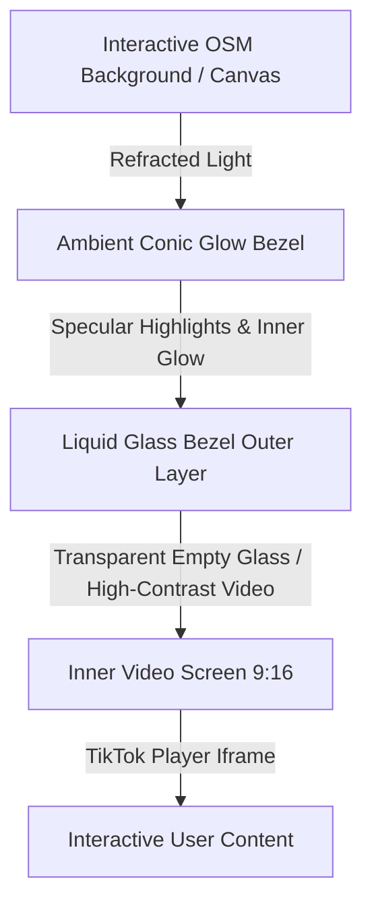
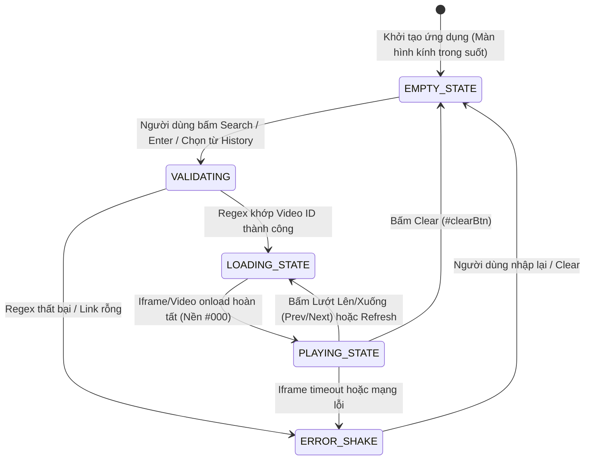

# ĐẶC TẢ KỸ THUẬT CHI TIẾT FRONTEND - TIKTOK LIQUID GLASS PLAYER


> **Phiên bản:** 2.1.0 | **Tiêu chuẩn:** Ultra-Premium Liquid Glassmorphism & GPU-Accelerated UI
> 
> 
> **Ngôn ngữ & Công nghệ:** HTML5, Vanilla CSS3 (Custom Properties & Multi-layered Compositing), JavaScript ES6+ (Native Modules), Vite, Leaflet.js (OpenStreetMap Engine).
> 
> 

---

## 1. TỔNG QUAN & TRIẾT LÝ THIẾT KẾ (DESIGN PHILOSOPHY)


Giao diện **TikTok Liquid Glass** không dừng lại ở hiệu ứng kính mờ (*Glassmorphism*) thông thường vốn chỉ dùng bộ lọc làm mờ đục tĩnh (`backdrop-filter: blur()`). Thay vào đó, kiến trúc tái tạo cảm giác **Kính Thể Lỏng Siêu Thực (Liquid Optical Glass)** dựa trên các định luật quang học vật lý:

1. **Khúc xạ ánh sáng (Refraction & Light Dispersion):** Bề mặt kính bẻ cong và tán sắc ánh sáng đi qua từ các phần tử chuyển động phía dưới (bản đồ vệ tinh/đô thị sống động của Leaflet OSM).


2. **Phản xạ đặc quyền rìa góc (Specular Edge Highlights):** Ánh sáng phản chiếu gắt và thanh mảnh tại các đường vát mép (bevels) với góc nghiêng $45^\circ - 135^\circ$.


3. **Độ sâu khối & Phát quang viền trong (Inner Bevel Glow & Depth):** Kết hợp nhiều lớp bóng âm (`inset box-shadow`) mô phỏng độ cong vòm lồi/lõm của thấu kính chất lỏng.


4. **Hiệu ứng tán sắc chu vi (Ambient Perimeter Glow):** Viền khung hiển thị video hấp thụ và tỏa màu động dựa trên dải màu Conic Gradient và GPU Canvas Texture.


5. **Zero-Lag GPU Compositing:** Đảm bảo duy trì ổn định **60 FPS** với chi phí vẽ lại (paint overhead) tối thiểu thông qua phân lớp phần cứng độc lập (`transform: translateZ(0)`).




---

## 2. HỆ THỐNG TOKEN THIẾT KẾ & CSS VARIABLES (DESIGN TOKENS)


Toàn bộ hệ thống được định nghĩa tập trung qua các biến CSS Custom Properties tại `:root`, tuân thủ phân tách rành mạch giữa màu sắc, kiểu chữ, hiệu ứng kính và hoạt ảnh:

### 2.1. Bảng màu & Kiểu chữ (Palette & Typography)


```css
:root {
  /* Typography Tokens */
  --font-primary: 'Plus Jakarta Sans', system-ui, -apple-system, sans-serif;
  --font-display: 'Outfit', system-ui, -apple-system, sans-serif;

  /* Base Chromatic Tokens */
  --bg-dark: #070913;
  --text-main: rgba(255, 255, 255, 0.95);
  --text-muted: rgba(255, 255, 255, 0.65);
  --text-dim: rgba(255, 255, 255, 0.4);
  
  /* Accent & Status Colors */
  --accent-cyan: #00f2fe;
  --accent-pink: #ff007f;
  --status-success: #00dfa2;
  --status-error: #ff2d55;
}

```

### 2.2. Đặc tả vật liệu kính thể lỏng (Liquid Glass Material Tokens)


| Tên biến CSS | Giá trị đặc tả kỹ thuật | Mục đích vật lý |
| --- | --- | --- |
| `--glass-bg` | `linear-gradient(135deg, rgba(255, 255, 255, 0.12), rgba(255, 255, 255, 0.03))` | Khúc xạ tán xạ bề mặt góc chéo

 |
| `--glass-bg-clear` | `linear-gradient(135deg, rgba(255, 255, 255, 0.06), rgba(255, 255, 255, 0.01))` | Lớp kính trong suốt cho khung hình khi chưa có video |
| `--glass-bg-hover` | `linear-gradient(135deg, rgba(255, 255, 255, 0.18), rgba(255, 255, 255, 0.05))` | Tụ quang khi có tác động con trỏ

 |
| `--glass-border` | `1px solid rgba(255, 255, 255, 0.22)` | Viền phản quang vi mô mờ tự nhiên

 |
| `--glass-border-hover` | `1px solid rgba(255, 255, 255, 0.5)` | Tán xạ viền phản quang mạnh

 |
| `--glass-border-active` | `1px solid rgba(255, 255, 255, 0.75)` | Tụ quang đỉnh điểm khi tương tác

 |
| `--glass-shadow` | `0 4px 16px 0 rgba(0, 0, 0, 0.2), inset 0 1px 1px rgba(255, 255, 255, 0.3)` | Bóng ngoài tách lớp + vát sáng mép trên

 |
| `--glass-shadow-hover` | `0 6px 20px 0 rgba(0, 0, 0, 0.26), inset 0 1px 1.5px rgba(255, 255, 255, 0.45)` | Tăng chiều sâu nổi 3D khi hover

 |
| `--glass-shadow-error` | `0 4px 16px 0 rgba(255, 45, 85, 0.2), inset 0 1px 1.5px rgba(255, 120, 150, 0.45)` | Ánh xạ tán sắc đỏ quang phổ cảnh báo lỗi

 |

### 2.3. Quy chuẩn hoạt ảnh (Animation Easing)


* **Gia tốc đường cong:** `--ease-smooth: cubic-bezier(0.25, 0.8, 0.25, 1)`


* **Thời lượng chuyển đổi chuẩn:** `transform 0.2s var(--ease-smooth), border-color 0.2s ease, background 0.2s ease`


* **Ép phần cứng GPU:** `transform: translateZ(0); backface-visibility: hidden; will-change: transform;`


---

## 3. KIẾN TRÚC BỐ CỤC ĐA LỚP (MULTI-LAYER VIEWPORT ARCHITECTURE)


Khung nhìn toàn màn hình (`100vw` $\times$ `100vh`, `overflow: hidden`) phân chia thành các tầng Z-index tuyệt đối:

```
[Z: 0]   .map-background-container  --> Bản đồ tương tác Leaflet OSM tự do kéo thả / Pan
[Z: 1]   .map-dark-overlay          --> Radial & Linear Dark Gradient cân bằng độ tương phản
[Z: 5]   .main-viewport             --> Khung lưới bao bọc phân phối không gian
[Z: 20]  .controls-area             --> Cụm điều khiển nổi góc dưới bên trái (Fixed Bottom-Left)
[Z: 30]  .left-floating-dock        --> Cụm 3 nút hành động nổi dọc cạnh trái màn hình
[Z: 50]  .video-display-area        --> Khung thiết bị Liquid Glass tỷ lệ 9:16 + Cụm nút nổi bên phải
[Z: 100] .app-header                --> Thanh trạng thái & Live FPS Monitor
[Z: 999] .toast-notification        --> Hệ thống thông báo Liquid Glass Toast

```

---

## 4. ĐẶC TẢ CHI TIẾT CÁC THÀNH PHẦN GIAO DIỆN (UI COMPONENTS)


### 4.1. Cụm điều khiển góc dưới bên trái (`.controls-area`)


* **Vị trí vật lý:** Cố định tại `bottom: 56px`, `left: 56px`, cách lề theo chuẩn công thái học thị giác.


* **Cấu trúc nhóm:** Xếp chồng dọc (`flex-direction: column`, `gap: 16px`) gồm 3 hàng:


#### A. Hàng Preset Chips (`.preset-chips-container`)


* **Kích thước:** Chiều cao `32px`, `border-radius: 9999px`, padding `6px 14px`.


* **Cấu trúc con:** Chứa 1 chấm phát quang mini 6px (`background: #00f2fe; box-shadow: 0 0 6px #00f2fe;`) và nhãn phân loại (Trend, Music, Dance...).


* **Hành vi:** Nhấp chuột sẽ tự động nạp URL TikTok mẫu chuẩn vào ô input và kích hoạt tìm kiếm tức thì.


#### B. Khung nhập liệu dạng viên thuốc (`.input-pill-wrapper`)


* **Kích thước:** Rộng linh hoạt `440px`, cao chuẩn `56px`, bo tròn cực đại `border-radius: 9999px`.


* Cấu trúc lớp kính:


* Lớp nền `var(--glass-bg)` kết hợp viền tán xạ `var(--glass-border)`.


* **Trạng thái `:focus-within`:** Viền sáng rực `rgba(255, 255, 255, 0.75)`, đổ bóng hào quang xanh ngọc `box-shadow: 0 0 18px rgba(0, 242, 254, 0.3)`, phóng đại nhẹ `transform: scale(1.02)`.


* Các slot chức năng tích hợp:


1. *Icon Slot (Trái):* Biểu tượng liên kết (Link SVG) chuyển sắc mờ `rgba(255, 255, 255, 0.65)`.


2. *Ô Input cốt lõi (`#videoUrlInput`):* `border: none; outline: none; background: transparent; font-size: 14px; color: #fff;` Placeholder: *"Dán đường dẫn video TikTok..."*.


3. *Nút Paste nhanh (`#pasteBtn`):* Nút kính mờ tròn 32px, đọc trực tiếp dữ liệu từ `navigator.clipboard`.


4. *Nút Clear (`#clearBtn`):* Nút kính mờ tròn 32px, reset sạch form và phục hồi trạng thái chờ.


#### C. Nút hành động tìm kiếm hình tròn (`.search-btn-circle`)


* **Kích thước:** Hình tròn hoàn hảo `56px` $\times$ `56px`, `border-radius: 50%`.


* **Vị trí:** Nằm ngang ngay cạnh phải của ô nhập liệu (`gap: 16px`).


* Hiệu ứng vật lý:


* **Hover:** Phóng lớn `transform: scale(1.08)`, viền sáng `rgba(255, 255, 255, 0.8)`, phát quang lưỡng sắc Neon TikTok `box-shadow: 0 0 24px rgba(255, 0, 127, 0.4), 0 0 16px rgba(0, 242, 254, 0.4)`. Icon kính lúp bên trong xoay nghiêng $15^\circ$ (`transform: rotate(15deg) scale(1.1)`).


* **Active:** Đàn hồi co lại `transform: scale(0.96)`.


---

### 4.2. Cụm nút hành động nổi bên trái (`.left-floating-dock`)

* **Vị trí vật lý:** Cố định dọc bên lề trái màn hình (`left: 24px`, căn giữa theo trục dọc vùng hiển thị giữa Header và Controls Area).


* **Bố cục:** Xếp chồng dọc (`display: flex; flex-direction: column; gap: 16px;`) gồm 3 nút hình tròn.


* **Chất liệu & Kích thước chung (`.glass-circle-btn`):**
* Hình tròn đường kính `44px` $\times$ `44px`, `border-radius: 50%`.
* Sử dụng đồng nhất chất liệu Liquid Glass như các nút hiện có: nền `var(--glass-bg)`, viền `var(--glass-border)`, đổ bóng `var(--glass-shadow)`, `backdrop-filter: blur(6px)`.
* **Hover / Active:** Chuyển nền sang `var(--glass-bg-hover)`, viền `var(--glass-border-hover)`, phóng nhẹ `transform: scale(1.08)` và đàn hồi `scale(0.95)` khi nhấn.


* **Thứ tự & Chức năng chi tiết (từ trên xuống dưới):**
1. **Vị trí thứ 1 - Các video đã thích (`#likedVideosBtn`):**
* **Icon:** Biểu tượng trái tim / Video yêu thích (Heart/Bookmark Video SVG).
* **Chức năng:** Mở danh sách/ngăn kéo các video TikTok mà người dùng đã lưu yêu thích.


2. **Vị trí thứ 2 - Các địa điểm đã thích (`#likedPlacesBtn`):**
* **Icon:** Biểu tượng ghim bản đồ kèm trái tim / Ngôi sao địa điểm (Saved Pin / Favorite Location SVG).
* **Chức năng:** Hiển thị danh sách các quán ăn/địa điểm đã lưu trên bản đồ.


3. **Vị trí thứ 3 - Lịch sử phân tích (`#analysisHistoryBtn`):**
* **Icon:** Biểu tượng đồng hồ lịch sử xoay ngược (History / Clock-Rotate-Left SVG).
* **Chức năng:** Mở nhật ký các video và địa điểm đã được hệ thống trích xuất, phân tích trước đó.


---

### 4.3. Khung thiết bị Liquid Glass Bezel 9:16 (`.liquid-glass-bezel`) & Cụm điều khiển bên phải


Khung hiển thị mô phỏng một thiết bị di động kính thể lỏng nguyên khối cao cấp với kết cấu **3 tầng quang học lồng ghép** đi kèm dải nút điều khiển nhanh dọc cạnh phải:

```
+-------------------------------------------------------------+
|  .liquid-glass-bezel (Outer Bezel - Bo góc 44px, Rộng 9:16)  |
|  [Layer 1: Ambient Perimeter Glow & Conic Gradient]          |
|  [Layer 2: Glass Surface Overlay + Specular Bevel Highlights]|
|                                                             |
|   +-----------------------------------------------------+   |  [MP4 Badge]
|   | .device-notch (Loa thoại + Camera trước phát sáng)  |   |  ( Refresh )
|   +-----------------------------------------------------+   |  ( Open TikTok )
|                                                             |  ( 1. Google Maps )
|   +-----------------------------------------------------+   |
|   | .video-screen (Inner Screen - Bo góc 30px)          |   |
|   |                                                     |   |
|   |   [State A] .empty-state: Lớp kính trong suốt       |   |
|   |             (Nhìn xuyên thấu trực tiếp xuống Map)   |   |  ( 2. Video Up ^ )
|   |   [State B] .loading-state: Shimmer Skeleton        |   |  ( 3. Video Down v )
|   |   [State C] .video-state: <iframe> TikTok Player    |   |
|   |             (Nền đen #000 khi phát video)           |   |
|   +-----------------------------------------------------+   |
+-------------------------------------------------------------+

```

#### A. Chi tiết kỹ thuật các lớp khung Bezel

:

1. **Kích thước thích ứng:** Chiều cao `height: min(675px, 85vh)`, chiều rộng tính toán chính xác theo tỷ lệ dọc: `width: calc(min(675px, 85vh) * 9 / 16)`.


2. **Lớp 1 - Nguồn phát quang chu vi (`.ambient-glow-gradient`):**


* Trải rộng `inset: -10px`, dùng dải màu `conic-gradient` 8 pha màu rực rỡ từ Cyan (`#00f0ff`), Magenta (`#ff007f`) đến Emerald (`#00ff88`).


* Chi phí GPU: $0\%$ Blur Filter Cost nhờ kỹ thuật giới hạn `overflow: hidden` của viền ngoài.


3. **Lớp 2 - Vỏ kính thể lỏng bề mặt (`.glass-surface-overlay`):**


* Lớp kính bóng bề mặt với `border: 1.5px solid rgba(255, 255, 255, 0.4)`.


* Tạo mép sáng vòm kép phản quang: `box-shadow: inset 0 1.5px 3px rgba(255, 255, 255, 0.55), inset 0 -1px 2px rgba(255, 255, 255, 0.2)`.


4. **Lớp 3 - Màn hình hiển thị trung tâm (`.video-screen`):**


* Nằm gọn trong lòng viền kính (`padding: 16px` ở vỏ ngoài giúp lộ viền kính nguyên bản), bo góc `border-radius: 30px`.


* **Trạng thái chưa có video (`.video-screen.is-empty`):**
* **Chất liệu kính trong suốt:** Không sử dụng nền đen. Áp dụng nền kính trong `background: var(--glass-bg-clear)` kết hợp `backdrop-filter: blur(2px)` nhẹ và bóng âm viền trong `box-shadow: inset 0 0 20px rgba(255, 255, 255, 0.08)`, cho phép nhìn xuyên thấu trực tiếp xuống bản đồ Leaflet OSM đang chuyển động phía dưới.


* **Trạng thái đang phát video (`.video-screen.is-playing`):**
* Chuyển sang nền đen thuần túy `background: #000` để hiển thị `<iframe>` hoặc `<video>` với độ tương phản cao và triệt tiêu viền răng cưa.


#### B. Cụm nút hành động nổi bên phải khung Video (`.right-action-dock`)

Nằm dọc sát bên phải ngoài khung `.liquid-glass-bezel` (`gap: 12px`), sử dụng chung thiết kế nút tròn chất liệu kính `.glass-circle-btn` (`40px` $\times$ `40px`, `border-radius: 50%`) tương đồng với nút *Refresh* và *Open in TikTok* có sẵn:

1. Nhóm điều khiển trên (Ngay dưới nút Refresh và Open in TikTok):


* **Vị trí bổ sung thứ 1 - Điều hướng qua Google Maps (`#googleMapNavBtn`):**
* **Icon:** Biểu tượng điều hướng / Ghim bản đồ Google Maps (Navigation Arrow / Map Pin SVG).
* **Chức năng:** Mở trực tiếp tọa độ hoặc địa chỉ quán ăn/địa điểm của video hiện tại sang tab Google Maps để chỉ đường.


2. Nhóm điều hướng luồng Video (Nằm ở nửa dưới cạnh phải khung hình):


* **Vị trí bổ sung thứ 2 - Lướt video lên trên (`#prevVideoBtn`):**
* **Icon:** Mũi tên hướng lên trên (`Chevron-Up` / `Arrow-Up` SVG).
* **Chức năng:** Chuyển về video trước đó trong danh sách phát / danh sách địa điểm.


* **Vị trí bổ sung thứ 3 - Lướt video xuống dưới (`#nextVideoBtn`):**
* **Icon:** Mũi tên hướng xuống dưới (`Chevron-Down` / `Arrow-Down` SVG).
* **Chức năng:** Lướt sang video tiếp theo trong danh sách phát / danh sách địa điểm.


---

### 4.4. Thanh trạng thái & Header Actions (`.app-header`)


* **Brand Badge:** Huy hiệu kính mờ hiển thị logo TikTok kèm nhãn `TikTok Liquid Glass`.


* **Bộ đo FPS trực tiếp (`#fpsBadge`):**


* Theo dõi khung hình theo thời gian thực sử dụng `requestAnimationFrame`.


* Đèn LED trạng thái đổi màu động: Xanh lục $\ge 50$ FPS (mượt mà), Vàng $30-49$ FPS, Đỏ $<30$ FPS.


* **Bộ điều khiển Bản đồ Đô thị (`#mapCityBtn`):**


* Cho phép người dùng "bay" (`flyTo`) qua các siêu đô thị thế giới (Tokyo, New York, London, Paris, Hà Nội).


* **Nút chuyển đổi chế độ ("No-Glass" Mode):**


* Liên kết trực tiếp sang phiên bản không kính để kiểm chứng sự vượt trội về mặt mỹ thuật của Liquid Glass.


---

## 5. ĐẶC TẢ LOGIC & MÁY TRẠNG THÁI (STATE MACHINE & LOGIC)


Frontend vận hành theo mô hình máy trạng thái hữu hạn (**FSM - Finite State Machine**) với 4 trạng thái cốt lõi:



### 5.1. Bộ phân tích & Chuẩn hóa URL (URL Parser Regex Engine)


Hệ thống hỗ trợ toàn diện các định dạng URL phát sinh từ TikTok:

1. **Link chuẩn Web:** `[https://www.tiktok.com/@username/video/7212345678901234567](https://www.tiktok.com/@username/video/7212345678901234567)`


2. **Link nhúng trực tiếp:** `[https://www.tiktok.com/embed/v2/7212345678901234567](https://www.tiktok.com/embed/v2/7212345678901234567)`


3. **Link chia sẻ ngắn di động:** `[https://vt.tiktok.com/ZSxxxxxx/](https://vt.tiktok.com/ZSxxxxxx/)` hoặc `[https://vm.tiktok.com/xxxx/](https://vm.tiktok.com/xxxx/)`


Biểu thức chính quy trích xuất ID:

```javascript
const TIKTOK_VIDEO_REGEX = /(?:video\/|v\/|embed\/v2\/|embed\/v1\/|\/v\/)(\d{15,22})/;

```

Đối với URL dạng short-link (`vt.tiktok.com`), hệ thống kiểm tra định dạng và cung cấp gợi ý người dùng hoặc chuyển tiếp phân giải.

### 5.2. Nhúng Iframe an toàn (Sandboxed Embed Architecture)


Iframe được khởi tạo động với các cờ bảo mật chuẩn:

```javascript
const iframe = document.createElement('iframe');
iframe.className = 'tiktok-iframe';
iframe.src = `https://www.tiktok.com/player/v1/${videoId}?autoplay=1&rel=0&native_context_menu=0`;
iframe.allow = 'accelerometer; autoplay; encrypted-media; gyroscope; picture-in-picture; fullscreen';
iframe.sandbox = 'allow-scripts allow-same-origin allow-popups allow-forms';

```

---

## 6. ĐẶC TẢ HIỆU NĂNG, KHẢ NĂNG TIẾP CẬN & TƯƠNG THÍCH


### 6.1. Chiến lược tối ưu GPU & Render Tree (60 FPS Strategy)


1. **Loại bỏ hiện tượng Overdraw & Blur Cascade:**


* Thay vì lồng nhiều lớp `backdrop-filter: blur(24px)` gây quá tải Rasterizer của GPU, hệ thống chỉ kích hoạt mức blur vi mô `2px - 6px` kết hợp với specular reflection và conic gradient mask.


2. **Hardware Layer Isolation:**


* Các phần tử chuyển động được cô lập vào Compositor Layer riêng bằng `transform: translateZ(0)` và `will-change: transform`.


3. **Debounced Event Handlers:**


* Sự kiện gõ phím, cuộn bản đồ, chuyển đổi video lên/xuống và resize màn hình đều được tối ưu thông qua debounce / `requestAnimationFrame`.


### 6.2. Tiêu chuẩn Tiếp cận (A11y - Accessibility)


* Tất cả nút bấm (bao gồm 3 nút dock bên trái và 3 nút điều hướng bên phải) và trường nhập liệu đều có `aria-label`, `title` và định danh `id` duy nhất.


* Hỗ trợ đầy đủ phím tắt bàn phím: `Enter` để thực thi tìm kiếm, `Escape` để hủy, `ArrowUp` / `ArrowDown` để lướt video lên/xuống, `Tab` điều hướng theo đúng thứ tự DOM.


* Thông báo lỗi qua Toast Notification có thuộc tính `role="alert"` phục vụ trình đọc màn hình.


### 6.3. Fallback cho trình duyệt cũ


Trong trường hợp trình duyệt không hỗ trợ `-webkit-backdrop-filter`:

```css
@supports not ((-webkit-backdrop-filter: blur(1px)) or (backdrop-filter: blur(1px))) {
  .liquid-glass {
    background: rgba(14, 18, 36, 0.92);
    border: 1px solid rgba(255, 255, 255, 0.3);
  }
  .video-screen.is-empty {
    background: rgba(14, 18, 36, 0.25);
  }
}

```

---

## 7. HƯỚNG DẪN KHỞI CHẠY DỰ ÁN


```bash
# 1. Cài đặt các gói phụ thuộc (Leaflet & Vite)
npm install

# 2. Khởi chạy Development Server với Live Reload
npm run dev
# Truy cập giao diện tại: http://localhost:5173/

# 3. Đóng gói sản phẩm tối ưu hóa Production
npm run build

# 4. Chạy kiểm thử bản đóng gói
npm run preview

```