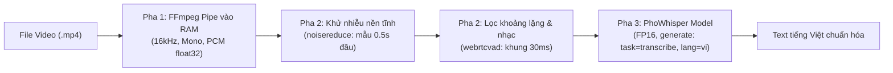

# 🛠️ TÀI LIỆU KỸ THUẬT: MODULE TẢI VIDEO & CHUYỂN ĐỔI GIỌNG NÓI SANG VĂN BẢN (SPEECH-TO-TEXT)

Tài liệu thiết kế kỹ thuật cho 2 chức năng thành phần trong hệ thống:
1. **Module Tải Video (TikTok / YouTube Shorts)**: Đối chiếu từ [[build_dataset_colab.ipynb](file:///d:/year_4/pbl/build_data/build/build_dataset_colab.ipynb)].
2. **Module Chuyển đổi Giọng nói sang Văn bản (Speech-to-Text)**: Đối chiếu từ [[speech_to_text_colab.ipynb](file:///d:/year_4/pbl/build_data/build/speech_to_text_colab.ipynb)].

---

## 1. MODULE TẢI VIDEO TỪ TIKTOK & YOUTUBE SHORTS

### 1.1. Mục tiêu & Phạm vi chức năng
- **Mục tiêu**: Tải video ngắn từ URL TikTok hoặc YouTube Shorts, lưu trữ dưới định dạng `.mp4` chuẩn (hình ảnh sắc nét nhất, âm thanh rõ nhất).
- **Đầu vào (Input)**:
  - `url`: Liên kết video TikTok (ví dụ: `https://www.tiktok.com/@user/video/123456789`) hoặc YouTube Shorts (ví dụ: `https://www.youtube.com/shorts/abcdef123`).
  - `output_dir`: Đường dẫn thư mục lưu file video.
  - `video_id` *(tùy chọn)*: Tên định danh file sau khi tải.
- **Đầu ra (Output)**:
  - File vật lý `{video_id}.mp4` tại `output_dir`.
  - Kết quả trả về gồm: `status` (`SUCCESS` / `FAILED`), `file_path`, `file_size_mb`, `duration_seconds`, `error_message`.

### 1.2. Công nghệ cốt lõi
- **`yt-dlp`**: Thư viện xử lý trích xuất và tải stream cho cả TikTok và YouTube.
- **`ffmpeg`**: Động cơ hợp nhất (merge) luồng hình ảnh tốt nhất và luồng âm thanh tốt nhất thành file chuẩn MP4 container.

### 1.3. Cấu hình Tải Video (`yt-dlp` Options)
Cấu hình tối ưu được đúc kết từ [[build_dataset_colab.ipynb](file:///d:/year_4/pbl/build_data/build/build_dataset_colab.ipynb)]:
- **Định dạng ưu tiên (`format`)**: `"bestvideo[ext=mp4]+bestaudio[ext=m4a]/best[ext=mp4]/best"`
- **Định dạng xuất (`merge_output_format`)**: `"mp4"`
- **Bảo vệ mạng & Chống treo**:
  - `socket_timeout`: 30 giây.
  - `retries`: 3 lần thử lại khi gặp lỗi mạng tạm thời.
  - `noplaylist`: `True` (chỉ tải đúng 1 video được chỉ định).
  - `nooverwrites`: `True` (không ghi đè nếu file đã tồn tại).

### 1.4. Thiết kế Triển khai (Core Implementation)

```python
import os
import time
import yt_dlp
from typing import Dict, Any

class VideoDownloader:
    def __init__(self, output_dir: str):
        self.output_dir = output_dir
        os.makedirs(self.output_dir, exist_ok=True)
        self.format_pref = "bestvideo[ext=mp4]+bestaudio[ext=m4a]/best[ext=mp4]/best"

    def download_video(self, url: str, video_id: str) -> Dict[str, Any]:
        """
        Tải video từ URL TikTok hoặc YouTube Shorts về thư mục đầu ra.
        """
        target_path = os.path.join(self.output_dir, f"{video_id}.mp4")

        # 1. Kiểm tra nếu file đã tồn tại hợp lệ
        if os.path.exists(target_path) and os.path.getsize(target_path) > 1000:
            size_mb = round(os.path.getsize(target_path) / (1024 * 1024), 2)
            return {
                "video_id": video_id,
                "status": "SKIPPED",
                "file_path": target_path,
                "file_size_mb": size_mb,
                "error_message": ""
            }

        outtmpl = os.path.join(self.output_dir, f"{video_id}.%(ext)s")
        ydl_opts = {
            'format': self.format_pref,
            'outtmpl': outtmpl,
            'merge_output_format': 'mp4',
            'noplaylist': True,
            'quiet': True,
            'no_warnings': True,
            'retries': 3,
            'fragment_retries': 3,
            'socket_timeout': 30,
            'nooverwrites': True,
        }

        start_time = time.time()
        try:
            with yt_dlp.YoutubeDL(ydl_opts) as ydl:
                ydl.download([url])

            # Kiểm tra file đã xuất ra thực tế
            actual_file = None
            for ext in ['.mp4', '.mkv', '.webm']:
                cand = os.path.join(self.output_dir, f"{video_id}{ext}")
                if os.path.exists(cand) and os.path.getsize(cand) > 1000:
                    actual_file = cand
                    break

            if actual_file:
                size_mb = round(os.path.getsize(actual_file) / (1024 * 1024), 2)
                return {
                    "video_id": video_id,
                    "status": "SUCCESS",
                    "file_path": actual_file,
                    "file_size_mb": size_mb,
                    "duration_seconds": round(time.time() - start_time, 2),
                    "error_message": ""
                }
            else:
                raise FileNotFoundError("Không tìm thấy file video sau khi yt-dlp hoàn tất.")

        except Exception as exc:
            err = str(exc)
            clean_err = "Video riêng tư" if "Private video" in err else \
                        "Video bị xóa hoặc không khả dụng" if ("unavailable" in err or "404" in err) else \
                        "Bị chặn truy cập / Rate limit" if "10231" in err else err[:150]
            return {
                "video_id": video_id,
                "status": "FAILED",
                "file_path": "",
                "file_size_mb": 0.0,
                "duration_seconds": round(time.time() - start_time, 2),
                "error_message": clean_err
            }
```

---

## 2. MODULE CHUYỂN ĐỔI GIỌNG NÓI SANG VĂN BẢN (SPEECH-TO-TEXT)

### 2.1. Mục tiêu & Phạm vi chức năng
- **Mục tiêu**: Nhận diện và chuyển đổi toàn bộ tiếng nói người thuyết minh trong video thành văn bản tiếng Việt có dấu, chuẩn ngữ nghĩa.
- **Đầu vào (Input)**: File video định dạng `.mp4` (hoặc audio).
- **Đầu ra (Output)**:
  - `text`: Chuỗi văn bản tiếng Việt đã được làm sạch và chuẩn hóa.
  - `status`: `SUCCESS` (có văn bản), `NO_SPEECH` (video chỉ có nhạc nền / không có tiếng người), `ERROR` (lỗi giải mã).
  - `duration_seconds`: Thời lượng âm thanh thực tế.

### 2.2. Công nghệ cốt lõi
- **`vinai/PhoWhisper`** (`vinai/PhoWhisper-medium`): Mô hình nhận dạng giọng nói tiếng Việt độ chính xác cao.
- **`FFmpeg In-Memory Streaming`**: Trích xuất âm thanh từ video trực tiếp vào RAM thành mảng PCM float32 16.000 Hz, không sinh file tạm.
- **`noisereduce`**: Giảm tạp âm môi trường và tiếng ồn nền tĩnh.
- **`webrtcvad`**: Bộ lọc phát hiện hoạt tính giọng nói (Voice Activity Detection), loại bỏ các đoạn chỉ có nhạc nền hoặc khoảng lặng.

### 2.3. Quy trình Xử lý Âm thanh 3 Pha



#### Pha 1: Trích xuất âm thanh trực tiếp vào RAM (In-Memory Streaming)
Không tạo file `.wav` trung gian trên đĩa cứng; dùng đường ống `pipe:1` đọc thẳng dữ liệu thô:
```python
def extract_audio_in_memory(video_path: str, sample_rate: int = 16000) -> np.ndarray:
    cmd = [
        "ffmpeg", "-v", "error", "-i", str(video_path),
        "-vn", "-ac", "1", "-ar", str(sample_rate),
        "-f", "s16le", "pipe:1"
    ]
    result = subprocess.run(cmd, capture_output=True)
    if result.returncode != 0 or len(result.stdout) == 0:
        return np.array([], dtype=np.float32)
    # Chuẩn hóa về dải float32 [-1.0, 1.0]
    return np.frombuffer(result.stdout, dtype="<i2").astype(np.float32) / 32768.0
```

#### Pha 2: Tiền xử lý âm thanh (Noise Reduction & VAD)
Ngăn chặn hiện tượng mô hình Whisper bị ảo giác (hallucination) lặp từ khi gặp nhạc nền hoặc khoảng lặng:
1. **Khử nhiễu nền tĩnh**: Lấy 0.5s đầu tiên của âm thanh làm mẫu phổ tạp âm, giảm 80% nhiễu (`prop_decrease=0.8`).
2. **WebRTC VAD (Voice Activity Detection)**: Cắt âm thanh thành các khung 30ms ($16000 \times 0.03 = 480$ mẫu). Sử dụng bộ lọc mức 2 (`Vad(2)`), chỉ giữ lại các khung có năng lượng giọng nói người (`voiced_frames`) và nối chúng lại.

#### Pha 3: Suy luận ASR với PhoWhisper
- Mô hình chạy chế độ `torch.float16` trên GPU để tăng tốc độ và tiết kiệm VRAM.
- Cấu hình pipeline: `chunk_length_s=30`, tham số sinh `task="transcribe"`, `language="vi"`.

### 2.4. Thiết kế Triển khai (Core Implementation)

```python
import subprocess
import numpy as np
import torch
import noisereduce as nr
import webrtcvad
from transformers import AutoModelForSpeechSeq2Seq, AutoProcessor, pipeline
from typing import Dict, Any

class SpeechToTextEngine:
    def __init__(self, model_id: str = "vinai/PhoWhisper-small", sample_rate: int = 16000):
        self.sample_rate = sample_rate
        self.use_cuda = torch.cuda.is_available()
        device = 0 if self.use_cuda else -1
        dtype = torch.float16 if self.use_cuda else torch.float32

        # Khởi tạo mô hình PhoWhisper
        processor = AutoProcessor.from_pretrained(model_id)
        model = AutoModelForSpeechSeq2Seq.from_pretrained(
            model_id,
            torch_dtype=dtype,
            low_cpu_mem_usage=True,
            use_safetensors=False,
        )
        if self.use_cuda:
            model.to("cuda")

        self.asr_pipeline = pipeline(
            "automatic-speech-recognition",
            model=model,
            tokenizer=processor.tokenizer,
            feature_extractor=processor.feature_extractor,
            chunk_length_s=30,
            device=device,
        )

    def _preprocess_audio(self, audio: np.ndarray) -> np.ndarray:
        """Khử nhiễu phổ và lọc bỏ khoảng lặng / nhạc nền bằng VAD."""
        if audio.size == 0:
            return audio

        # 1. Khử nhiễu với mẫu từ 0.5s đầu
        noise_sample = audio[: min(len(audio), int(self.sample_rate * 0.5))]
        denoised = nr.reduce_noise(
            y=audio,
            sr=self.sample_rate,
            y_noise=noise_sample,
            stationary=True,
            prop_decrease=0.8,
        )

        # 2. WebRTC VAD lọc đoạn không có tiếng người (cửa sổ 30ms)
        pcm = np.clip(denoised * 32767, -32768, 32767).astype(np.int16)
        vad = webrtcvad.Vad(2)
        frame_size = int(self.sample_rate * 0.03)
        voiced_frames = []

        for start in range(0, len(pcm), frame_size):
            frame = pcm[start : start + frame_size]
            if len(frame) < frame_size:
                frame = np.pad(frame, (0, frame_size - len(frame)))
            if vad.is_speech(frame.tobytes(), self.sample_rate):
                voiced_frames.append(frame)

        if not voiced_frames:
            return denoised

        return np.concatenate(voiced_frames).astype(np.float32) / 32767.0

    def transcribe_video(self, video_path: str) -> Dict[str, Any]:
        """Trích xuất âm thanh từ video và chuyển thành văn bản."""
        # 1. Trích xuất âm thanh trực tiếp qua FFmpeg pipe
        cmd = [
            "ffmpeg", "-v", "error", "-i", str(video_path),
            "-vn", "-ac", "1", "-ar", str(self.sample_rate),
            "-f", "s16le", "pipe:1"
        ]
        res = subprocess.run(cmd, capture_output=True)
        if res.returncode != 0 or len(res.stdout) == 0:
            return {
                "text": "",
                "duration_seconds": 0.0,
                "status": "NO_AUDIO",
                "error_message": "Không có luồng âm thanh hoặc lỗi giải mã FFmpeg"
            }

        raw_audio = np.frombuffer(res.stdout, dtype="<i2").astype(np.float32) / 32768.0
        duration_sec = round(len(raw_audio) / float(self.sample_rate), 2)

        # 2. Tiền xử lý âm thanh (Noise reduce & VAD)
        clean_audio = self._preprocess_audio(raw_audio)

        # 3. Suy luận qua PhoWhisper
        try:
            result = self.asr_pipeline(
                {"raw": clean_audio, "sampling_rate": self.sample_rate},
                generate_kwargs={"task": "transcribe", "language": "vi"}
            )
            raw_text = str(result.get("text", "")).strip()
            clean_text = " ".join(raw_text.split())

            return {
                "text": clean_text,
                "duration_seconds": duration_sec,
                "status": "SUCCESS" if clean_text else "NO_SPEECH",
                "error_message": ""
            }
        except Exception as e:
            return {
                "text": "",
                "duration_seconds": duration_sec,
                "status": "ERROR",
                "error_message": str(e)[:150]
            }
```

---

## 3. TÓM TẮT ĐẶC TẢ KỸ THUẬT (SYSTEM SPECIFICATION)

| Tiêu chí | Module Tải Video | Module Speech-to-Text |
|---|---|---|
| **Chức năng chính** | Tải stream video MP4 từ TikTok / YouTube Shorts | Chuyển đổi giọng nói trong video sang văn bản tiếng Việt |
| **Đầu vào** | URL video (`str`) | File video MP4 (`str`) |
| **Đầu ra** | File `{video_id}.mp4` | Chuỗi văn bản tiếng Việt `text` (`str`) |
| **Thư viện chính** | `yt-dlp`, `ffmpeg` | `transformers`, `torch`, `noisereduce`, `webrtcvad`, `ffmpeg` |
| **Mô hình AI** | Không | `vinai/PhoWhisper` (Small / Medium) |
| **Cơ chế nạp Audio** | Không áp dụng | Đọc trực tiếp vào RAM qua `pipe:1` của FFmpeg (In-memory) |
| **Xử lý đặc thù** | Merge MP4 container, bắt lỗi riêng tư / 404 / 10231 | Khử nhiễu nền tĩnh 0.5s + lọc khoảng lặng / nhạc bằng VAD 30ms |
| **Yêu cầu tài nguyên** | CPU, Băng thông mạng | GPU (hỗ trợ CUDA FP16, tối thiểu 4GB - 8GB VRAM) |
