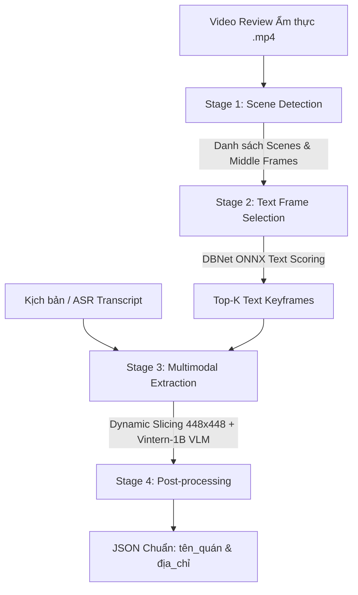

# Restaurant Video Information Extraction Pipeline

Quy trình chuẩn (Standard Operating Procedure - SOP) và hướng dẫn kiến trúc cho hệ thống trích xuất thông tin quán ăn (tên quán, địa chỉ) từ video review ẩm thực kết hợp giữa phân tích thị giác chuyển cảnh, nhận diện văn bản (OCR) và mô hình đa phương thức ngôn ngữ thị giác (VLM).

---

## 1. Tổng quan Kiến trúc Hệ thống

Hệ thống được thiết kế theo mô hình **Pipeline đa tầng (Multi-stage Pipeline)** với nguyên tắc **Loose Coupling, High Cohesion** (Phân tách độc lập, dễ kiểm thử và bảo trì):



### Các tầng xử lý chính:

1. **Stage 1 (Phát hiện chuyển cảnh)**:
   - Thư viện: `PySceneDetect` (`ContentDetector` hoặc `AdaptiveDetector`).
   - Mục đích: Chia nhỏ video thành các phân cảnh độc lập và lấy khung hình đại diện (middle frame).
2. **Stage 2 (Lọc khung hình chứa văn bản biển hiệu)**:
   - Mô hình: `DBNet ONNX` (từ `tham_khao/onnx`).
   - Mục đích: Chấm điểm trực tiếp trong RAM (`box_count`, `avg_score`, `text_area_ratio`, `composite_score`) để chọn Top-K frame có xác suất cao nhất chứa biển hiệu/tên quán/menu.
3. **Stage 3 (Suy luận đa phương thức VLM)**:
   - Mô hình: `5CD-AI/Vintern-1B-v3_5` (kiến trúc InternVL2 + Qwen2).
   - Tiền xử lý: `dynamic_preprocess` chia ảnh thành các block 448x448 bảo toàn độ nét của chữ nhỏ trên bảng hiệu.
   - Prompt: Ghép các token `<image>` cùng kịch bản (transcript) ép cấu trúc đầu ra JSON.
4. **Stage 4 (Xử lý kết quả & Batch Processing)**:
   - Regex JSON Parser trích xuất an toàn `tên_quán`, `địa_chỉ`.
   - Batch processor hỗ trợ đọc `video_speech_to_text.csv`, checkpoint lưu tiến độ, xử lý lỗi từng video độc lập.

---

## 2. Thiết kế Cấu trúc Thư mục `src/` (Dễ bảo trì)

Cấu trúc dự án bên trong `g:\マイドライブ\colab\pbl\main\src` được module hóa:

```text
src/
├── __init__.py
├── config/                     # Quản lý cấu hình tập trung
│   ├── __init__.py
│   └── settings.py             # Dataclass / Cấu hình đường dẫn, ngưỡng phân cảnh, model parameters
│
├── utils/                      # Tiện ích chung độc lập
│   ├── __init__.py
│   ├── io_utils.py             # Đọc/ghi ảnh an toàn với ký tự Unicode/Tiếng Nhật (cv2_imread, cv2_imwrite)
│   └── logger.py               # Thiết lập logging chuẩn hóa
│
├── detectors/                  # Module tiền xử lý thị giác (Vision Preprocessing)
│   ├── __init__.py
│   ├── scene_detector.py       # Wrapper PySceneDetect (phát hiện phân cảnh)
│   ├── text_detector.py        # Wrapper DBNet ONNX (tính text metrics trong RAM)
│   └── frame_selector.py       # Điều phối: Trích xuất frame giữa phân cảnh & xếp hạng Top-K text frames
│
├── vlm/                        # Module mô hình thị giác ngôn ngữ (Multimodal VLM)
│   ├── __init__.py
│   ├── preprocessor.py         # Dynamic resolution transform & dynamic_preprocess (448x448)
│   ├── prompt_builder.py       # Tạo prompt chuẩn hóa kèm thẻ <image> và kịch bản
│   └── vintern_extractor.py    # Wrapper tải mô hình Vintern-1B, quản lý VRAM, chat inference & parse JSON
│
├── pipeline/                   # Tầng điều phối tổng thể (Orchestration Layer)
│   ├── __init__.py
│   └── restaurant_pipeline.py  # Ghép nối Frame Selector -> VLM Extractor -> Kết quả chuẩn
│
├── batch/                      # Tầng xử lý hàng loạt dữ liệu
│   ├── __init__.py
│   └── batch_processor.py      # Đọc CSV video_speech_to_text.csv, quản lý resume, lưu log/kết quả
│
└── main.py                     # CLI Entrypoint duy nhất cho toàn bộ hệ thống
```

---

## 3. Quy chuẩn Thực thi & Hướng dẫn Mã nguồn

### 3.1. Xử lý đường dẫn Unicode & Google Drive trên Windows
- Không dùng trực tiếp `cv2.imread` và `cv2.imwrite` với các đường dẫn chứa ký tự tiếng Nhật như `マイドライブ`.
- Phải luôn dùng hàm chuyển đổi mảng bytes:
  ```python
  def cv2_imread(path, flags=cv2.IMREAD_COLOR):
      data = np.fromfile(path, dtype=np.uint8)
      return cv2.imdecode(data, flags) if len(data) > 0 else None

  def cv2_imwrite(path, img):
      ext = os.path.splitext(path)[1] or ".jpg"
      ret, buf = cv2.imencode(ext, img)
      if ret:
          buf.tofile(path)
          return True
      return False
  ```

### 3.2. Quản lý Bộ nhớ (RAM & VRAM)
- **Tối ưu RAM**: Không lưu toàn bộ frame video vào đĩa cứng. Đọc và chấm điểm Text metrics ngay trên mảng numpy trong bộ nhớ. Chỉ giữ lại Top-K frame được chọn.
- **Tối ưu VRAM GPU**:
  - `DBNet ONNX`: Sử dụng `CUDAExecutionProvider` với giới hạn bộ nhớ hoặc fallback về `CPUExecutionProvider`.
  - `Vintern-1B`: Khởi tạo với kiểu dữ liệu `torch.bfloat16` (hoặc `float16`), giới hạn số patch `max_num=4` hoặc `6` trong `dynamic_preprocess` để tránh tràn VRAM trên Colab T4.
  - Sau mỗi batch video, gọi `torch.cuda.empty_cache()` nếu cần giải phóng bộ nhớ.

### 3.3. Khắc phục lỗi tương thích Transformers & InternVL
Áp dụng monkey patch trước khi nạp model để tránh crash trên Transformers >= 4.48:
```python
from transformers.configuration_utils import PretrainedConfig
from transformers.modeling_utils import PreTrainedModel

_orig_to_diff_dict = PretrainedConfig.to_diff_dict
PretrainedConfig.to_diff_dict = lambda self: (
    _orig_to_diff_dict(self) if not hasattr(self, 'llm_config') or self.llm_config else self.to_dict()
)
if not hasattr(PreTrainedModel, "all_tied_weights_keys"):
    PreTrainedModel.all_tied_weights_keys = property(lambda self: getattr(self, "_tied_weights_keys", {}))
```

---

## 4. Runbook: Kiểm tra và Vận hành

### 4.0. Cài đặt Thư viện trên Google Colab
Trước khi thực thi lệnh `python src/main.py`, cần cài đặt các thư viện phụ thuộc:
```bash
pip install -q -r requirements.txt
# Hoặc lệnh cài đặt trực tiếp:
pip install -q "scenedetect[opencv]" pyclipper shapely "transformers<5.0.0,>=4.48" accelerate torchvision torch opencv-python pillow peft timm einops sentencepiece onnxruntime-gpu
```

### 4.1. Kiểm tra từng module độc lập (Unit Test / Smoke Test)

1. **Kiểm tra Frame Selector**:
   ```bash
   python -m src.detectors.frame_selector --video "G:\マイドライブ\colab\PBL_Build_Data\videos\test.mp4" --top_k 3
   ```
   *Kỳ vọng*: Trả về danh sách 3 frame kèm điểm `composite_score` mà không cần nạp mô hình VLM nặng.

2. **Kiểm tra VLM Extractor**:
   ```bash
   python -m src.vlm.vintern_extractor --images "path/to/frame1.jpg" "path/to/frame2.jpg" --script "Quán phở 10 Lý Quốc Sư..."
   ```
   *Kỳ vọng*: Trả về dictionary `{"tên_quán": "Phở 10 Lý Quốc Sư", "địa_chỉ": "10 Lý Quốc Sư"}`.

### 4.2. Chạy Pipeline hoàn chỉnh
```bash
# Chạy đơn lẻ 1 video:
python src/main.py --mode single --video "path/to/video.mp4" --script "Nội dung kịch bản..."

# Chạy hàng loạt theo file CSV:
python src/main.py --mode batch --csv "video_speech_to_text.csv" --videos_dir "G:\マイドライブ\colab\PBL_Build_Data\videos" --limit 10
```

---

## 5. Danh mục Kiểm tra trước khi Triển khai (Checklist)

- [ ] File cấu hình `settings.py` cho phép cấu hình linh hoạt qua biến môi trường hoặc tham số CLI.
- [ ] Tách biệt hoàn toàn code DBNet ONNX ra khỏi script monolithic cũ.
- [ ] Không sinh các file ảnh rác trung gian không cần thiết trên Google Drive.
- [ ] Xử lý ngoại lệ đầy đủ: Video hỏng, video không có tiếng/kịch bản rỗng, frame không tìm thấy chữ, mô hình sinh JSON lỗi cú pháp.
- [ ] Giao diện API rõ ràng dạng Class (`RestaurantExtractorPipeline.process(...)`) để dễ dàng import vào Jupyter Notebook hoặc Colab.
