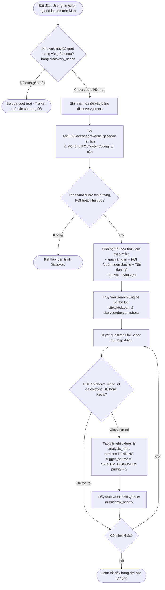
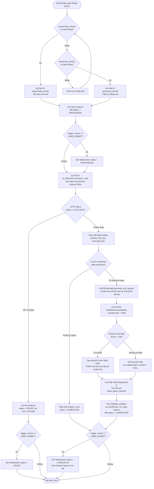

# ĐẶC TẢ HỆ THỐNG HOÀN CHỈNH: FOOD SPOT BACKEND (AGENT SYSTEM SPECIFICATION)

Tài liệu này là bộ đặc tả kỹ thuật chuẩn hóa (Ground Truth) hợp nhất toàn bộ kiến trúc, cơ sở dữ liệu không gian, luồng xử lý bất đồng bộ, hàng đợi ưu tiên kép và giao thức kết nối AI cho dự án **Food Spot Backend**.

---

## 1. TỔNG QUAN KIẾN TRÚC & CÔNG NGHỆ

### 1.1. Ngăn xếp công nghệ (Tech Stack)

* **Ngôn ngữ & Runtime**: Python >= 3.11, Uvicorn.


* **Framework**: FastAPI hỗ trợ đồng thời REST API và WebSocket thời gian thực.


* **Cơ sở dữ liệu & GIS**: PostgreSQL tích hợp tiện ích không gian **PostGIS**.


* **ORM & Migration**: SQLAlchemy, GeoAlchemy2 (xử lý kiểu hình học `Geometry(POINT, 4326)`), Alembic.


* **Hàng đợi & Cache**: Redis (quản lý Dual-Priority Job Queue và chống trùng lặp URL).


* **Async HTTP Client**: `httpx` (giao tiếp bất đồng bộ với External AI Server và ArcGIS Geocoder).


* **Xác thực & Kiểm thử**: JWT Bearer Token, Passlib/Bcrypt, Pydantic v2, Pytest (`pytest-asyncio`).


### 1.2. Cấu trúc thư mục chuẩn hóa

```text
backend/
├── app/
│   ├── api/
│   │   ├── deps.py                  # Dependency injection (DB session, JWT current user)
│   │   └── v1/
│   │       ├── endpoints/
│   │       │   ├── auth.py          # Đăng ký, đăng nhập, lấy thông tin tài khoản
│   │       │   ├── health.py        # Kiểm tra trạng thái hệ thống
│   │       │   ├── videos.py        # Submit URL video, tra cứu lịch sử phân tích
│   │       │   ├── places.py        # Tìm kiếm không gian PostGIS, xem video theo quán
│   │       │   ├── saved.py         # Bookmark lưu/bỏ lưu video và địa điểm
│   │       │   └── ws.py            # WebSocket endpoint nhận thông báo real-time
│   │       └── router.py            # Gom nhóm toàn bộ API routes
│   ├── core/
│   │   ├── config.py                # Biến môi trường (DB, JWT, AI URL, Redis)
│   │   ├── security.py              # Hash mật khẩu & tạo/giải mã JWT
│   │   └── websocket_manager.py     # Quản lý kết nối WebSocket theo user_id
│   ├── db/
│   │   └── session.py               # Khởi tạo kết nối PostgreSQL/PostGIS
│   ├── models/                      # SQLAlchemy & GeoAlchemy2 Models (8 bảng)
│   ├── schemas/                     # Pydantic v2 Request/Response Schemas
│   ├── services/
│   │   ├── auth_service.py          # Nghiệp vụ xác thực
│   │   ├── video_service.py         # Nghiệp vụ quản lý video
│   │   ├── analysis_service.py      # Điều phối hàng đợi & gọi External AI Server
│   │   ├── geocoding_service.py     # Chuẩn hóa địa chỉ & tọa độ qua ArcGIS Geocoder
│   │   ├── discovery_service.py     # Tự động sinh từ khóa & cào video theo vị trí
│   │   ├── place_service.py         # Truy vấn bán kính PostGIS & thông tin quán
│   │   └── saved_service.py         # Nghiệp vụ lưu trữ mục yêu thích
│   └── main.py                      # Entrypoint khởi chạy ứng dụng & background workers
├── alembic/                         # Quản lý lịch sử migration database
├── tests/                           # Unit test & Integration test
├── .env.example
├── alembic.ini
├── requirements.txt
└── README.md

```

---

## 2. ACTIVITY DIAGRAMS (UML) & MÔ TẢ LUỒNG HOẠT ĐỘNG

### 2.1. Liên kết tổng thể giữa các chức năng (Cross-Function Interaction)

Hệ thống vận hành xoay quanh vòng lặp làm giàu dữ liệu bản đồ tự động và phục vụ người dùng theo thời gian thực:

1. **Nguồn thu thập dữ liệu (Ingestion)**: Hệ thống nhận link video từ hai nguồn: người dùng chủ động gửi link (`USER_SUBMIT` - Ưu tiên 1) và tiến trình tự động quét từ vị trí ghim trên bản đồ (`SYSTEM_DISCOVERY` - Ưu tiên 2).


2. **Xử lý & Chuẩn hóa (Processing & Geocoding)**: Worker ưu tiên xử lý yêu cầu của người dùng trước, gọi External AI Server để trích xuất tên quán/địa chỉ, sau đó gọi `ArcGISGeocoder` để chuyển địa chỉ văn bản thành tọa độ không gian PostGIS (`POINT`).


3. **Phân phối & Tương tác (Delivery & Engagement)**: Kết quả hoàn tất được đẩy tức thời qua WebSocket về cho người dùng, đồng thời làm giàu trực tiếp vào bảng `places` và `video_place_matches`. Khi người dùng quét bản đồ theo bán kính hoặc bấm vào một quán ăn, dữ liệu từ cả hai nguồn sẽ được truy vấn qua PostGIS để đề xuất video và cho phép lưu vào danh sách yêu thích.


---

### 2.2. Luồng 1: Người dùng gửi link video phân tích (User On-Demand Submission)


* **Các bước xử lý & Điều kiện rẽ nhánh**:
1. **Kiểm tra xác thực và định dạng**: Xác thực JWT của người dùng đang hoạt động (`is_active == True`), sau đó kiểm tra mẫu URL hợp lệ của TikTok hoặc YouTube để bóc tách `platform_video_id`.


2. **Rẽ nhánh kiểm tra tồn tại Video (`Get or Create`)**:
* *Nhánh chưa tồn tại*: Lưu thông tin đường dẫn gốc (`source_url`), `platform` và `platform_video_id` vào bảng `videos`.


* *Nhánh đã tồn tại*: Lấy `video.id` sẵn có để tránh trùng lặp bản ghi. Nếu video đã có kết quả phân tích thành công, hệ thống có thể trả ngay dữ liệu địa điểm đã khớp.


3. **Khởi tạo tiến trình ưu tiên cao**: Tạo bản ghi `analysis_runs` với `status = PENDING`, `trigger_source = USER_SUBMIT`, `priority = 1`, đẩy vào `queue:high_priority` và phản hồi ngay lập tức cho Client để không làm treo giao diện.


---

### 2.3. Luồng 2: Chủ động khám phá & Cào video theo vị trí bản đồ (Location-Based Auto Discovery)



* **Các bước xử lý & Điều kiện rẽ nhánh**:
1. **Kiểm tra lịch sử vùng quét (`discovery_scans`)**: Khi người dùng chọn một tọa độ `(lat, lon)`, hệ thống kiểm tra xem bán kính quanh điểm đó đã được quét gần đây chưa để tránh spam truy vấn.


2. **Nghịch đảo tọa độ & Sinh từ khóa**: Gọi `ArcGISGeocoder.reverse_geocode(lat, lon)` để lấy địa chỉ thực tế (tên địa danh như Đại học Bách Khoa, tên đường như Nguyễn Lương Bằng, Ngô Sĩ Liên, phường/quận) rồi ghép vào các mẫu từ khóa ẩm thực.


3. **Tìm kiếm & Phân loại vào hàng đợi thấp**: Truy vấn công cụ tìm kiếm để thu thập danh sách link TikTok/YouTube Shorts, lọc bỏ các video đã có trong hệ thống và đẩy các video mới vào hàng đợi ưu tiên thấp (`queue:low_priority`) với `trigger_source = SYSTEM_DISCOVERY` và `priority = 2`.


---

### 2.4. Luồng 3: Worker điều phối Hàng đợi kép, Gọi AI Server & Chuẩn hóa tọa độ ArcGIS



* **Các bước xử lý & Điều kiện rẽ nhánh**:
1. **Chiến lược ưu tiên tuyệt đối (Strict Priority Polling)**: Worker luôn kiểm tra `queue:high_priority` trước; chỉ khi hàng đợi của người dùng hoàn toàn trống thì Worker mới rút tác vụ từ `queue:low_priority`.


2. **Giao tiếp AI Server**: Chuyển trạng thái sang `PROCESSING`, gửi request bất đồng bộ sang `AI_SERVER_EXTRACT_URL`. Nếu xảy ra lỗi mạng, timeout quá 180 giây hoặc AI trả về thất bại, hệ thống gọi `fail_analysis()`, lưu `error_message` và bắn thông báo lỗi qua WebSocket.


3. **Chuẩn hóa địa chỉ & Geocoding qua ArcGIS**:
* Địa chỉ thô từ `data.restaurant.address` được tiền xử lý qua Regex (thay viết tắt `q.`, `p.`, `đ.`, `hn`, `tphcm`, tách số nhà và thêm tiền tố `Đường`) để sinh danh sách biến thể truy vấn.


* Gọi duy nhất dịch vụ **ArcGIS World Geocoder** (`countryCode=VNM`). Ưu tiên chọn ứng viên khớp chính xác số nhà (`PointAddress` / `AddNum`) hoặc có điểm tin cậy `Score >= 80`.


* Nếu tìm thấy tọa độ: Khởi tạo điểm hình học PostGIS `ST_SetSRID(ST_MakePoint(lon, lat), 4326)` lưu vào bảng `places`. Nếu không tìm thấy: Vẫn lưu tên và địa chỉ thô vào `places` với `location = None` để không làm mất dữ liệu trích xuất.


---

### 2.5. Luồng 4: Truy vấn Bán kính trên Map, Xem chi tiết Quán & Lưu Yêu thích


---

## 3. ĐẶC TẢ CƠ SỞ DỮ LIỆU & POSTGIS SCHEMA

Migration khởi tạo của Alembic bắt buộc thực thi câu lệnh kích hoạt PostGIS đầu tiên:

```sql
CREATE EXTENSION IF NOT EXISTS postgis;

```

### Chi tiết 8 Bảng Dữ liệu

| STT | Tên bảng | Các cột chính & Kiểu dữ liệu | Ràng buộc & Chỉ mục (Constraints & Indexes) |
| --- | --- | --- | --- |
| 1 | **`users`** | `id` (PK), `email` (String), `username` (String), `hashed_password` (String), `is_active` (Boolean, Default `True`), `created_at` (DateTime)

 | Unique Index trên `email` và `username`.

 |
| 2 | **`places`** | `id` (PK), `name` (String), `address` (Text), `normalized_address` (Text, Nullable), `location` (`Geometry('POINT', srid=4326)`, Nullable), `latitude` (Float, Nullable), `longitude` (Float, Nullable), `category` (String, Nullable), `created_at` (DateTime)

 | Spatial Index (GIST) tự động trên cột `location`; Index trên `name`.

 |
| 3 | **`videos`** | `id` (PK), `platform` (String: `tiktok`/`youtube`), `platform_video_id` (String), `source_url` (Text), `title` (Text, Nullable), `duration_seconds` (Float, Nullable), `file_size_mb` (Float, Nullable), `transcript_text` (Text, Nullable), `created_at` (DateTime)

 | Unique Index trên `platform_video_id` để chống trùng lặp video.

 |
| 4 | **`video_place_matches`** | `id` (PK), `video_id` (FK -> `videos.id`), `place_id` (FK -> `places.id`), `confidence_status` (String: `HIGH`/`MEDIUM`/`LOW`), `evidence_sources` (JSONB: `["audio", "vision"]`), `matched_at` (DateTime)

 | Khóa ngoại liên kết N-N giữa `videos` và `places`; UniqueConstraint(`video_id`, `place_id`).

 |
| 5 | **`analysis_runs`** | `id` (PK), `user_id` (FK -> `users.id`, Nullable cho System Discovery), `video_id` (FK -> `videos.id`), `status` (`PENDING`, `PROCESSING`, `COMPLETED`, `FAILED`), `trigger_source` (`USER_SUBMIT`, `SYSTEM_DISCOVERY`), `priority` (Integer: `1` hoặc `2`), `keyframes_data` (JSONB), `ocr_data` (JSONB), `execution_metrics` (JSONB), `error_message` (Text, Nullable), `created_at`, `updated_at`

 | Index trên (`status`, `priority`, `created_at`) để truy vấn tiến trình nhanh.

 |
| 6 | **`saved_videos`** | `id` (PK), `user_id` (FK -> `users.id`), `video_id` (FK -> `videos.id`), `created_at` (DateTime)

 | `UniqueConstraint('user_id', 'video_id', name='uq_user_saved_video')`.

 |
| 7 | **`saved_places`** | `id` (PK), `user_id` (FK -> `users.id`), `place_id` (FK -> `places.id`), `created_at` (DateTime)

 | `UniqueConstraint('user_id', 'place_id', name='uq_user_saved_place')`.

 |
| 8 | **`discovery_scans`** | `id` (PK), `center_location` (`Geometry('POINT', srid=4326)`), `radius_m` (Float), `keywords_generated` (JSONB), `videos_found_count` (Integer), `scanned_at` (DateTime)

 | Spatial Index trên `center_location` để kiểm tra vùng đã quét.

 |

---

## 4. ĐẶC TẢ TÍCH HỢP DỊCH VỤ NGOÀI (EXTERNAL AI & ARCGIS)

### 4.1. Giao thức kết nối External AI Server (`app/services/analysis_service.py`)

* **Cấu hình (`app/core/config.py`)**:
* `AI_SERVER_EXTRACT_URL = "[https://capacity-broker-banners-targeted.trycloudflare.com/api/v1/extract](https://capacity-broker-banners-targeted.trycloudflare.com/api/v1/extract)"`.


* `AI_REQUEST_TIMEOUT = 180` (giây).


* **Request Payload**: `POST` với JSON body `{"url": "<source_url>"}`.


* **Ánh xạ dữ liệu Response từ AI vào Database**:
* `data.video` (`duration_seconds`, `file_size_mb`) & `data.transcript.text` $\rightarrow$ Cập nhật vào bảng `videos`.


* `data.restaurant` (`name`, `address`, `confidence_status`, `evidence_sources`) $\rightarrow$ Chuyển qua `ArcGISGeocoder` để lấy tọa độ, lưu vào bảng `places` và `video_place_matches`.


* `data.keyframes`, `data.frames_ocr_details`, `data.execution_metrics` $\rightarrow$ Lưu vào các cột JSONB tương ứng của bảng `analysis_runs`.


### 4.2. Dịch vụ Chuẩn hóa & Định vị Tọa độ (`app/services/geocoding_service.py`)

Hệ thống **chỉ sử dụng duy nhất ArcGIS World Geocoding Service** (loại bỏ hoàn toàn Nominatim và Photon OSM):

1. **Tiền xử lý chuỗi địa chỉ (`generate_sub_queries`)**:
* Chuyển các dấu gạch ngang `" - "` thành dấu phẩy `", "`.


* Áp dụng từ điển Regex mở rộng viết tắt tiếng Việt (`tp.`, `tphcm`, `hn`, `q.`, `p.`, `tx.`, `tt.`, `đ.`, `ng.`, `h.`) và tên quận hay viết tắt (`phú` $\rightarrow$ `Phú Nhuận`, `bình thạnh`, `gò vấp`...).


* Bóc tách số nhà ở đầu chuỗi và tự động chèn tiền tố `"Đường"` kèm dấu phẩy ngăn cách tên quận/thành phố để tối ưu hóa độ chính xác `PointAddress` của ArcGIS.


2. **Forward Geocoding (`geocode_address`)**:
* Gọi `GET [https://geocode.arcgis.com/arcgis/rest/services/World/GeocodeServer/findAddressCandidates](https://geocode.arcgis.com/arcgis/rest/services/World/GeocodeServer/findAddressCandidates)` với `countryCode=VNM`, `maxLocations=5`.


* **Luật chọn ứng viên**: Ưu tiên số 1 là ứng viên có `AddNum` hoặc `Match_addr`/`LongLabel` chứa chính xác số nhà mục tiêu; ưu tiên số 2 là ứng viên đứng đầu có `score >= 80`.


* Trả về bộ 3 giá trị `(latitude, longitude, normalized_address)` để tạo `WKTElement(f"POINT({lon} {lat})", srid=4326)`.


3. **Reverse Geocoding (`reverse_geocode`)**:
* Gọi `GET [https://geocode.arcgis.com/arcgis/rest/services/World/GeocodeServer/reverseGeocode](https://geocode.arcgis.com/arcgis/rest/services/World/GeocodeServer/reverseGeocode)` với `location=f"{lon},{lat}"` và `langCode="vi"` để lấy tên đường/địa danh phục vụ tiến trình tự động sinh từ khóa cào video.


---

## 5. ĐẶC TẢ REAL-TIME WEBSOCKET (`app/core/websocket_manager.py`)

* **Endpoint**: `WS /api/v1/ws?token=<JWT_ACCESS_TOKEN>`.


* **Cơ chế quản lý**: Lớp `ConnectionManager` duy trì từ điển `active_connections: dict[int, list[WebSocket]]` ánh xạ từ `user_id` sang danh sách các thiết bị đang mở kết nối của người dùng đó.


* **Payload sự kiện chuẩn gửi về Client**:

```json
{
  "event": "ANALYSIS_UPDATED",
  "data": {
    "analysis_run_id": 45,
    "video_id": 12,
    "status": "COMPLETED",
    "restaurant": {
      "id": 8,
      "name": "GIEF HO",
      "address": "34 Ngọc Khánh, Ba Đình, Hà Nội",
      "latitude": 21.0285,
      "longitude": 105.8154
    },
    "error_message": null
  }
}

```

---

## 6. ĐẶC TẢ CHI TIẾT CÁC NHÓM REST API ENDPOINTS

### 6.1. Nhóm Authentication (`/api/v1/auth`)

* `POST /api/v1/auth/register`: Đăng ký tài khoản mới, băm mật khẩu bằng Bcrypt.


* `POST /api/v1/auth/login`: Đăng nhập bằng `username` hoặc `email`, trả về JWT Bearer Token.


* `GET /api/v1/auth/me`: Trả về thông tin tài khoản hiện tại từ JWT.


### 6.2. Nhóm Video & Phân tích (`/api/v1/videos`)

* `POST /api/v1/videos/submit`: Nhận URL video, lưu hoặc lấy bản ghi `videos`, tạo `analysis_runs` (`priority=1`) và đẩy vào `queue:high_priority`.


* `GET /api/v1/videos`: Danh sách các video do người dùng hiện tại gửi.


* `GET /api/v1/videos/{video_id}`: Xem chi tiết video và các quán ăn đã khớp (kiểm tra phân quyền, trả `404` nếu truy cập trái phép).


* `GET /api/v1/videos/analysis`: Lịch sử các lần yêu cầu phân tích của người dùng.


* `GET /api/v1/videos/analysis/{analysis_run_id}`: Xem trạng thái, `keyframes_data`, `ocr_data` và `execution_metrics` của một lượt chạy.


### 6.3. Nhóm Khám phá Bản đồ & Địa điểm (`/api/v1/places`)

* `GET /api/v1/places/nearby-videos`:
* **Query Params**: `lat` (float, bắt buộc), `lon` (float, bắt buộc), `radius_m` (float, mặc định `2000.0`, tối đa `50000`), `limit` (`20`), `offset` (`0`).


* **Xử lý**: Sử dụng hàm `ST_DWithin` và `ST_Distance` trên kiểu `Geography` của PostGIS để lọc và sắp xếp các video có quán ăn nằm trong bán kính từ gần đến xa. Nếu số lượng điểm trong vùng quá ít, kích hoạt ngầm tiến trình `DiscoveryService` đẩy link vào `queue:low_priority`.


* `GET /api/v1/places/search`: Tìm kiếm địa điểm theo từ khóa tên quán hoặc địa chỉ.


* `GET /api/v1/places/{place_id}`: Lấy thông tin chi tiết một địa điểm ăn uống.


* `GET /api/v1/places/{place_id}/videos`: Lấy toàn bộ video review của quán `place_id`, sắp xếp ưu tiên `confidence_status == 'HIGH'` lên đầu và thời gian mới nhất (`created_at DESC`).


### 6.4. Nhóm Lưu trữ Yêu thích (`/api/v1/saved`)

* **Saved Videos**:
* `POST /api/v1/saved/videos/{video_id}`: Lưu video yêu thích (hỗ trợ Idempotent: trả `201 Created` nếu mới, `200 OK` nếu đã lưu).


* `DELETE /api/v1/saved/videos/{video_id}`: Bỏ lưu video (`204 No Content`).


* `GET /api/v1/saved/videos`: Danh sách video đã lưu kèm địa điểm tương ứng, sắp xếp theo `created_at DESC`.


* **Saved Places**:
* `POST /api/v1/saved/places/{place_id}`: Lưu địa điểm yêu thích (Idempotent).


* `DELETE /api/v1/saved/places/{place_id}`: Bỏ lưu địa điểm (`204 No Content`).


* `GET /api/v1/saved/places`: Danh sách địa điểm đã lưu kèm tọa độ (`lat`, `lon`) và tổng số lượng video review (`video_count`) của từng quán.


---

## 7. QUY TẮC BẮT BUỘC DÀNH CHO AI CODING AGENT (STRICT CODING RULES)

1. **Phân tách tầng kiến trúc (Separation of Concerns)**:
* Các file trong `app/api/v1/endpoints/` chỉ nhận HTTP request, xác thực quyền qua `deps.py` và trả về Pydantic schema.


* Toàn bộ logic nghiệp vụ, gọi AI Server, Geocoding và truy vấn PostGIS phải đặt trong `app/services/`.


2. **Quy chuẩn tọa độ PostGIS (Longitude trước, Latitude sau)**:
* Mọi thao tác tạo điểm không gian với PostGIS và GeoAlchemy2 bắt buộc tuân thủ hệ tọa độ **WGS 84 (`SRID=4326`)** với thứ tự tham số là **Kinh độ (`lon`) trước, Vĩ độ (`lat`) sau**: `ST_MakePoint(lon, lat)` hoặc `POINT(lon lat)`.


3. **Bất đồng bộ hoàn toàn (Non-blocking I/O)**:
* Tuyệt đối không dùng thư viện đồng bộ `requests` bên trong các hàm `async def` của FastAPI; bắt buộc dùng `httpx.AsyncClient` cho cả AI Server và ArcGIS Geocoder.


4. **Quản lý cấu hình & Migration**:
* Mọi thay đổi trong `app/models/` phải đi kèm file migration Alembic (`alembic revision --autogenerate` và `alembic upgrade head`).


* Không hardcode URL, mật khẩu DB hay JWT secret trong code; đọc toàn bộ qua `app/core/config.py` từ file `.env`.