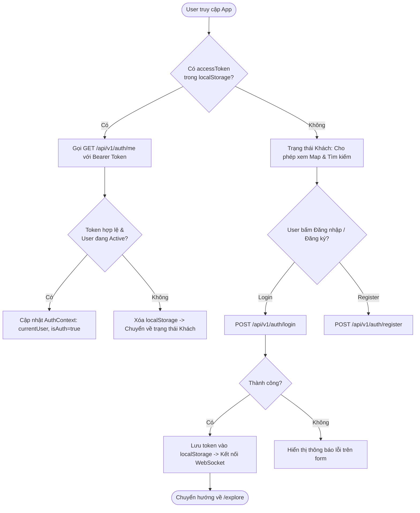
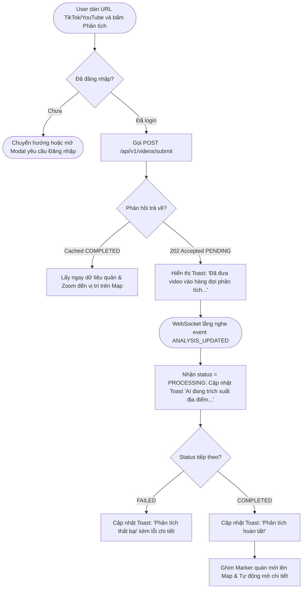
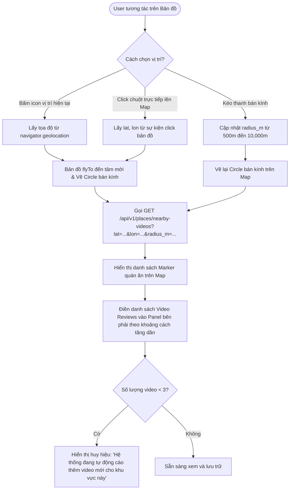
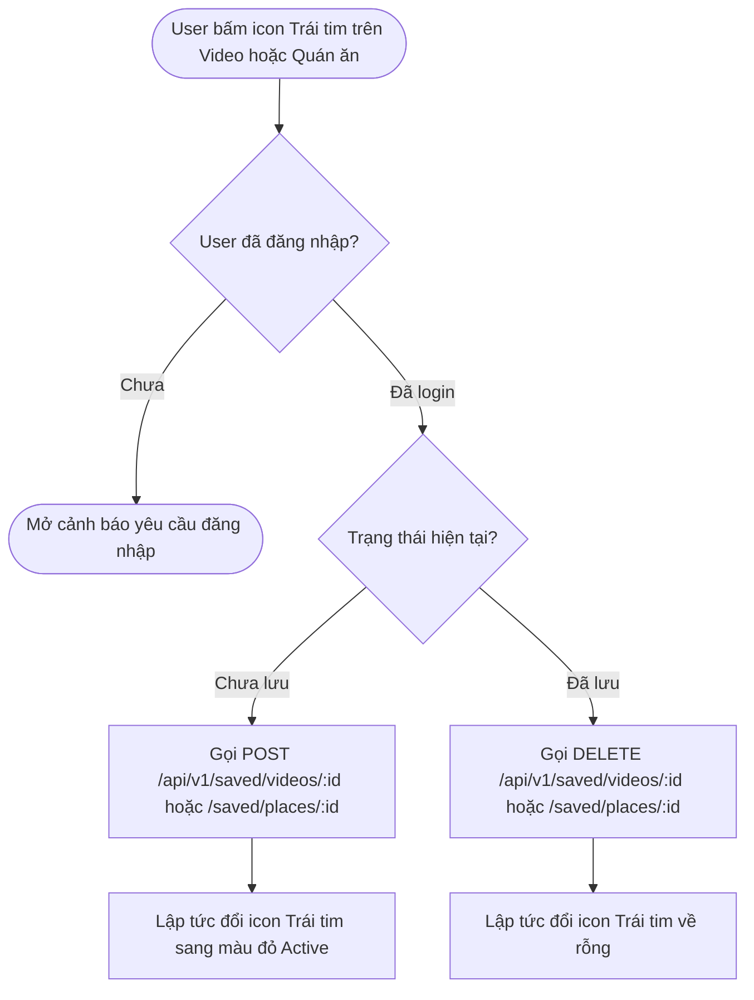

# ĐẶC TẢ HỆ THỐNG HOÀN CHỈNH: FOOD SPOT FRONTEND WEB (GROUND TRUTH SPECIFICATION)

Tài liệu này là bộ đặc tả kỹ thuật chuẩn hóa (Ground Truth Specification) hợp nhất toàn bộ kiến trúc giao diện, tương tác bản đồ không gian, luồng xác thực JWT, kết nối REST API Backend và giao thức nhận sự kiện thời gian thực qua WebSocket cho dự án **Food Spot Frontend Web**.

---

## 1. TỔNG QUAN KIẾN TRÚC & CÔNG NGHỆ

### 1.1. Ngăn xếp công nghệ (Tech Stack)

* **Runtime & Bundler**: Node.js >= 18, Vite.
* **Framework**: React 19 (TypeScript), React Router v7.
* **Bản đồ số & GIS**: Leaflet, `react-leaflet` (hiển thị bản đồ nền CARTO Voyager / OpenStreetMap, ghim Marker, vòng tròn bán kính Circle).
* **Quản lý Trạng thái (State Management)**: React Context API + Custom Hooks (`AuthContext`, `AnalysisSocketContext`, `MapContext`).
* **Icons**: `lucide-react`.
* **Giao thức Giao tiếp**:
  * **Async REST Client**: Fetch API bọc lớp Interceptor tự động đính kèm `Authorization: Bearer <JWT_TOKEN>`, xử lý refresh/logout khi gặp mã lỗi 401.
  * **Real-time WebSocket**: Native WebSocket Client kết nối tới `/api/v1/ws?token=<JWT>`, cơ chế tự động kết nối lại (exponential backoff reconnect) và lắng nghe sự kiện `ANALYSIS_UPDATED`.
* **Kiểu dáng & Design System**: Vanilla CSS với CSS Custom Properties (Tokens) định vị màu sắc thương hiệu (Emerald Green, Dark Navy, Slate Neutrals).

---

## 2. CẤU TRÚC THƯ MỤC CHUẨN HÓA

```text
front/
├── public/
│   ├── food-spot.svg                # Logo và favicon chính thức
│   └── vite.svg
├── src/
│   ├── api/                         # Tầng kết nối mạng (API Client & WebSocket)
│   │   ├── client.ts                # Base Fetch client với Auth Interceptor & Error Handling
│   │   ├── auth.ts                  # API: Đăng nhập, Đăng ký, Lấy thông tin tài khoản hiện tại
│   │   ├── videos.ts                # API: Submit video URL, Danh sách video, Lịch sử phân tích
│   │   ├── places.ts                # API: Tìm kiếm bán kính nearby-videos, Search quán, Chi tiết quán & Videos
│   │   ├── saved.ts                 # API: Lưu/bỏ lưu Video và Địa điểm (Idempotent 201/200/204)
│   │   └── ws.ts                    # WebSocket Manager: kết nối, reconnect, dispatch sự kiện
│   ├── contexts/                    # Quản lý trạng thái toàn cục
│   │   ├── AuthContext.tsx          # Trạng thái người dùng đăng nhập, JWT token, login, logout
│   │   └── AnalysisContext.tsx      # Quản lý tiến trình phân tích video qua WebSocket & Toast thông báo
│   ├── types/                       # TypeScript interfaces đồng bộ 100% với Pydantic Backend
│   │   ├── auth.ts                  # User, LoginRequest, RegisterRequest, AuthResponse
│   │   ├── video.ts                 # Video, VideoSubmitResponse, AnalysisRun
│   │   ├── place.ts                 # Place, NearbyVideoItem, PlaceVideoMatchItem
│   │   ├── saved.ts                 # SavedVideoItem, SavedPlaceItem
│   │   └── ws.ts                    # WebSocketMessage, AnalysisUpdatePayload
│   ├── components/                  # Các UI components chuyên biệt và tái sử dụng
│   │   ├── map/
│   │   │   ├── ExploreMap.tsx       # Bản đồ Leaflet tương tác, flyTo, click ghim vị trí
│   │   │   └── ExploreMap.css
│   │   ├── video/
│   │   │   ├── VideoCard.tsx        # Thẻ hiển thị video review (thumbnail, title, platform, nút lưu)
│   │   │   ├── VideoEmbedModal.tsx  # Modal phát video TikTok / YouTube Shorts nhúng iframe
│   │   │   └── VideoSubmitBar.tsx   # Thanh nhập URL video phân tích nổi bật
│   │   ├── place/
│   │   │   └── PlaceDetailModal.tsx # Xem chi tiết quán ăn, tọa độ và toàn bộ video review liên quan
│   │   ├── common/
│   │   │   ├── Toast.tsx            # Thông báo trạng thái phân tích (Pending, Processing, Completed, Failed)
│   │   │   └── LoadingSkeleton.tsx  # Hiệu ứng chờ tải dữ liệu
│   │   └── Icon.tsx
│   ├── pages/                       # Các trang màn hình chính
│   │   ├── MainLayout.tsx           # Layout khung với Sidebar điều hướng, Header và User Menu
│   │   ├── MainLayout.css
│   │   ├── FoodSpotLanding.tsx      # Trang giới thiệu ứng dụng (Landing Page)
│   │   ├── Login.tsx                # Trang đăng nhập tài khoản thật
│   │   ├── Register.tsx             # Trang đăng ký tài khoản thật
│   │   ├── Explore.tsx              # Workspace chính: Bản đồ khám phá + Panel video lân cận
│   │   ├── SavedVideos.tsx          # Danh sách video đã lưu từ backend
│   │   └── SavedPlaces.tsx          # Danh sách quán ăn đã lưu kèm video_count từ backend
│   ├── styles/
│   │   ├── tokens.css               # Hệ màu sắc, typography, khoảng cách, bo góc chuẩn
│   │   ├── global.css               # Reset và cài đặt typography cơ bản
│   │   └── shell.css                # Khung hiển thị và Sidebar responsive
│   ├── App.tsx                      # Định tuyến routes và bọc Providers
│   ├── main.tsx                     # Entrypoint React 19
│   └── vite-env.d.ts
├── index.html
├── package.json
├── tsconfig.json
├── vite.config.ts
└── README.md
```

---

## 3. LUỒNG HOẠT ĐỘNG VÀ DIAGRAMS TƯƠNG TÁC (ACTIVITY FLOWS)

### 3.1. Luồng 1: Xác thực & Quản lý Phiên Người dùng (Authentication Flow)



---

### 3.2. Luồng 2: Gửi URL Video & Nhận Thông báo Real-time (Video Submission & Live Push)



---

### 3.3. Luồng 3: Khám phá Bán kính trên Bản đồ (Location-based Map Exploration)



---

### 3.4. Luồng 4: Lưu & Bỏ lưu Bookmark Idempotent (Saved Videos & Places)



---

## 4. ĐẶC TẢ CHI TIẾT CÁC CONTRACTS API BACKEND

Frontend kết nối với Backend thông qua tiền tố cấu hình `VITE_API_BASE_URL` (mặc định `http://localhost:8000`).

### 4.1. Nhóm Authentication (`/api/v1/auth`)

| Endpoint | Method | Body / Params | Phản hồi Thành công | Mô tả |
|---|---|---|---|---|
| `/api/v1/auth/register` | `POST` | `{"username": str, "email": str, "password": str, "full_name": str}` | `201 Created`: `{"id": UUID, "username": str, "email": str, ...}` | Đăng ký tài khoản mới |
| `/api/v1/auth/login` | `POST` | `{"username_or_email": str, "password": str}` | `200 OK`: `{"access_token": str, "token_type": "bearer"}` | Đăng nhập lấy JWT Bearer Token |
| `/api/v1/auth/me` | `GET` | Headers: `Authorization: Bearer <token>` | `200 OK`: `{"id": UUID, "username": str, "email": str, "full_name": str, ...}` | Lấy thông tin user hiện tại |

---

### 4.2. Nhóm Video & Phân tích (`/api/v1/videos`)

| Endpoint | Method | Body / Params | Phản hồi Thành công | Mô tả |
|---|---|---|---|---|
| `/api/v1/videos/submit` | `POST` | `{"video_url": str, "force_reanalyze": bool}` | `202 Accepted`: `{"analysis_run_id": UUID, "video_id": UUID, "status": "PENDING", "cached": bool}` | Gửi link TikTok/YouTube phân tích |
| `/api/v1/videos` | `GET` | `?limit=20&offset=0` | `200 OK`: `list[Video]` | Lấy danh sách video do chính user đã gửi |
| `/api/v1/videos/{video_id}` | `GET` | Path: `video_id` | `200 OK`: `Video` (trả về 404 nếu không có quyền) | Xem chi tiết 1 video |
| `/api/v1/videos/analysis` | `GET` | `?limit=20&offset=0` | `200 OK`: `list[AnalysisStatusResponse]` | Xem lịch sử các lượt chạy phân tích |
| `/api/v1/videos/analysis/{run_id}` | `GET` | Path: `run_id` | `200 OK`: `AnalysisStatusResponse` | Chi tiết keyframes, OCR và metrics |

---

### 4.3. Nhóm Bản đồ & Địa điểm (`/api/v1/places`)

| Endpoint | Method | Query Parameters | Phản hồi Thành công | Mô tả |
|---|---|---|---|---|
| `/api/v1/places/nearby-videos` | `GET` | `lat` (float), `lon` (float), `radius_m` (mặc định 2000), `limit` (20), `offset` (0) | `200 OK`: `list[NearbyVideoItem]` (kèm `distance_m`, `is_saved`) | Lọc video trong bán kính tâm bản đồ |
| `/api/v1/places/search` | `GET` | `q` (str), `category` (str), `limit`, `offset` | `200 OK`: `list[PlaceResponse]` | Tìm kiếm địa điểm theo tên hoặc địa chỉ |
| `/api/v1/places/{place_id}` | `GET` | Path: `place_id` | `200 OK`: `PlaceResponse` | Chi tiết một quán ăn |
| `/api/v1/places/{place_id}/videos` | `GET` | Path: `place_id`, `limit=50` | `200 OK`: `list[PlaceVideoMatchItem]` | Danh sách video review của quán (ưu tiên HIGH) |

---

### 4.4. Nhóm Lưu trữ Yêu thích (`/api/v1/saved`)

| Endpoint | Method | Path / Params | Phản hồi Thành công | Mô tả |
|---|---|---|---|---|
| `/api/v1/saved/videos/{video_id}` | `POST` | Path: `video_id` | `201 Created` (mới) hoặc `200 OK` (đã có) | Lưu video yêu thích (Idempotent) |
| `/api/v1/saved/videos/{video_id}` | `DELETE` | Path: `video_id` | `204 No Content` | Bỏ lưu video yêu thích |
| `/api/v1/saved/videos` | `GET` | `?limit=20&offset=0` | `200 OK`: `list[SavedVideoResponse]` | Danh sách video đã lưu kèm quán ăn |
| `/api/v1/saved/places/{place_id}` | `POST` | Path: `place_id` | `201 Created` hoặc `200 OK` | Lưu địa điểm yêu thích (Idempotent) |
| `/api/v1/saved/places/{place_id}` | `DELETE` | Path: `place_id` | `204 No Content` | Bỏ lưu địa điểm yêu thích |
| `/api/v1/saved/places` | `GET` | `?limit=20&offset=0` | `200 OK`: `list[SavedPlaceResponse]` (kèm `video_count`) | Danh sách quán đã lưu kèm tổng video |

---

## 5. ĐẶC TẢ GIAO THỨC WEBSOCKET THỜI GIAN THỰC

* **Đường dẫn**: `WS /api/v1/ws?token=<JWT_ACCESS_TOKEN>`.
* **Cơ chế tái kết nối**: Tự động thử lại khi mất mạng (1s, 2s, 4s, tối đa 30s).
* **Định dạng dữ liệu nhận từ Server**:
  ```json
  {
    "event": "ANALYSIS_UPDATED",
    "data": {
      "analysis_run_id": "9b1deb4d-3b7d-4bad-9bdd-2b0d7b3dcb6d",
      "video_id": "1b9d6bcd-bbfd-4b2d-9b5d-ab8dfbbd4bed",
      "status": "PROCESSING", // hoặc "COMPLETED" | "FAILED"
      "restaurant": {
        "id": "c9a646d3-9c61-4cc9-bc55-c29e612f0260",
        "name": "Bún chả Hương Liên",
        "address": "24 Lê Văn Hưu, Hai Bà Trưng, Hà Nội",
        "latitude": 21.0186,
        "longitude": 105.8532
      },
      "error_message": null
    }
  }
  ```
* **Hành vi phía Frontend khi nhận sự kiện**:
  1. `status == "PROCESSING"`: Hiển thị Toast thông báo: *"AI đang trích xuất dữ liệu quán ăn..."*.
  2. `status == "COMPLETED"`:
     * Cập nhật Toast thành công: *"Đã nhận diện quán: {name}"*.
     * Tự động điều hướng bản đồ (`flyTo`) đến tọa độ của quán ăn mới `(latitude, longitude)`.
     * Tự động chèn ghim nổi bật và mở panel thông tin quán.
  3. `status == "FAILED"`: Hiển thị thông báo thất bại kèm `error_message`.

---

## 6. THIẾT KẾ GIAO DIỆN & DESIGN SYSTEM (UI/UX SPECIFICATION)

### 6.1. Bảng màu chuẩn (Color Palette)
* **Primary (Brand Green)**: `#10b981` (Emerald), `#059669` (Dark Emerald).
* **Secondary / Accent**: `#f59e0b` (Amber Gold cho điểm nổi bật/rating).
* **Dark / Background**: `#0f172a` (Slate 900 cho Sidebar/Header tối), `#f8fafc` (Slate 50 cho nền sáng).
* **Surface / Cards**: `#ffffff` với viền mềm `#e2e8f0` và đổ bóng `box-shadow: 0 4px 6px -1px rgba(0, 0, 0, 0.05)`.
* **Trạng thái**:
  * Success: `#10b981`
  * Pending/Processing: `#3b82f6` (Blue)
  * Error/Failed: `#ef4444` (Red)

### 6.2. Bản đồ & Trải nghiệm Người dùng trên Map
* Nguồn tiles: **CARTO Voyager** (`https://{s}.basemaps.cartocdn.com/rastertiles/voyager/{z}/{x}/{y}{r}.png`) với độ hiển thị sắc nét, địa danh tiếng Việt rõ ràng.
* Tọa độ khởi tạo: Trung tâm Đà Nẵng / Hội An `[15.8801, 108.3380]` hoặc Vị trí định vị của người dùng.
* Marker tùy biến: Ghim tròn màu xanh emerald có biểu tượng chiếc thìa/dĩa hoặc hình đồ ăn, có animation nhịp đập (pulse effect) khi quán mới được phân tích thành công.

---

## 7. KẾ HOẠCH TRIỂN KHAI THEO TỪNG GIAI ĐOẠN (STEP-BY-STEP ROADMAP)

* **Giai đoạn 1**: Cấu hình môi trường & Xây dựng tầng Types + API Client (Fetch with Interceptor, Auth API, Videos API, Places API, Saved API, WebSocket Client).
* **Giai đoạn 2**: Xây dựng Contexts Quản lý phiên (`AuthContext` kết nối backend thật, `AnalysisContext` lắng nghe WebSocket và Toast UI).
* **Giai đoạn 3**: Hoàn thiện các trang Xác thực: Nâng cấp `Login.tsx` và `Register.tsx` kết nối API thật, lưu trữ JWT an toàn.
* **Giai đoạn 4**: Nâng cấp trang Khám phá `Explore.tsx` & Bản đồ `ExploreMap.tsx`:
  * Tích hợp thanh submit video gọi `POST /api/v1/videos/submit`.
  * Tích hợp quét bán kính gọi `GET /api/v1/places/nearby-videos`.
  * Hiển thị danh sách video review và modal chi tiết quán ăn kèm video độ tin cậy cao.
* **Giai đoạn 5**: Nâng cấp `SavedVideos.tsx` và `SavedPlaces.tsx` kết nối API danh sách yêu thích và hỗ trợ bỏ lưu tức thời.
* **Giai đoạn 6**: Kiểm thử toàn diện, tối ưu responsive trên Mobile/Desktop và xác thực build với `npm run build`.