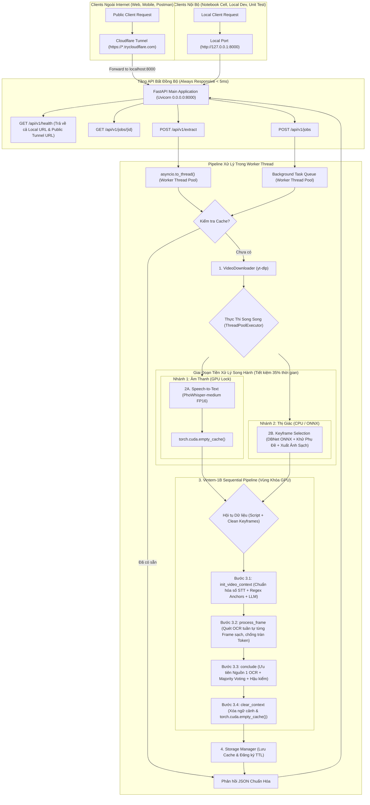

# 🚀 TÀI LIỆU KỸ THUẬT & QUY TRÌNH XÂY DỰNG AI SERVER (RESTAURANT VIDEO EXTRACTION)

Tài liệu này đóng vai trò là **Skill / Kế hoạch kiến trúc kỹ thuật chuẩn (Standard Operating Procedure - SOP)** nhằm chuyển đổi dự án hiện tại từ việc xử lý video & kịch bản offline sang một **AI Server độc lập chuẩn Production (Standalone AI REST API Server)**.

Hệ thống được thiết kế chuyên biệt để vận hành mạnh mẽ trên **Google Colab (GPU T4/A100)** hoặc máy chủ Local/Cloud, tự động thiết lập **Cầu Nối Mạng Công Khai (Public HTTPS Tunnel)** để các ứng dụng Web/Mobile bên ngoài có thể gọi API, đồng thời vẫn duy trì **Cổng Nội Bộ (Local Port: `http://127.0.0.1:8000`)** phục vụ kiểm thử nhanh ngay trong Colab hoặc môi trường phát triển cục bộ.

---

## 📑 MỤC LỤC
1. [Tổng quan Kiến trúc Hệ thống Server](#1-tổng-quan-kiến-trúc-hệ-thống-server)
   - 1.1. Sơ đồ Luồng Dữ liệu & Xử lý Song Hành (Parallel STT + Vision)
   - 1.2. Các Nguyên tắc Thiết kế Cốt lõi
2. [Đặc tả Đầu vào & Đầu ra (I/O Specification)](#2-đặc-tả-đầu-vào--đầu-ra-io-specification)
   - 2.1. Dữ liệu Đầu vào (Request Payload)
   - 2.2. Dữ liệu Đầu ra Chuẩn hóa (Response Payload)
3. [Thiết kế Chi tiết Các Tầng Xử lý & Tích hợp Module](#3-thiết-kế-chi-tiết-các-tầng-xử-lý--tích-hợp-module)
   - 3.1. Module Tải Video (`VideoDownloader`)
   - 3.2. Module Speech-to-Text (`SpeechToTextEngine` - PhoWhisper-medium)
   - 3.3. Module Keyframe & Khử Phụ Đề TikTok (`TextKeyframeSelector` + Clean Frame Extraction)
   - 3.4. Module Đa phương thức VLM (`Vintern1BExtractor` - Sequential Frame Processing & Context Caching v2)
   - 3.5. Module Quản lý Bộ nhớ Đệm & Dọn Rác Ổ Cứng (`StorageManager` + TTL Auto-cleaner)
   - 3.6. Pipeline Điều phối Tổng thể (`ServerExtractionPipeline` - Chạy Song Song STT & Keyframe)
4. [Quản trị Tài nguyên Phần cứng, VRAM & GPU Concurrency](#4-quản-trị-tài-nguyên-phần-cứng-vram--gpu-concurrency)
   - 4.1. Phân tích Mức Tiêu thụ VRAM Thực tế (Static vs Peak)
   - 4.2. Chiến lược Tách Biệt Tài Nguyên (GPU cho STT/VLM vs CPU cho DBNet) để Chạy Song Song
   - 4.3. Khóa Điều phối Độc quyền GPU Toàn diện (Unified GPU Semaphore)
   - 4.4. Giải pháp Chống Nghẽn Event Loop FastAPI (`asyncio.to_thread`)
5. [Cơ Chế Cầu Nối Mạng Colab & Cổng Test Local (Dual-Access Architecture)](#5-cơ-chế-cầu-nối-mạng-colab--cổng-test-local-dual-access-architecture)
   - 5.1. Mô hình Truy Cập Song Hành (Dual-Access: Local Port vs Public Tunnel)
   - 5.2. Giải pháp Cầu Nối Số 1: Cloudflare Tunnel (Miễn phí, Không cần tài khoản)
   - 5.3. Giải pháp Cầu Nối Dự Phòng: Ngrok Tunnel (Hỗ trợ Static Subdomain)
   - 5.4. Cấu hình CORS Đa Nguồn & Bảo Vệ Kết Nối
   - 5.5. Hướng Dẫn Vận Hành Trực Tiếp Trên Google Colab Notebook
6. [Đặc tả RESTful API (FastAPI Endpoints)](#6-đặc-tả-restful-api-fastapi-endpoints)
   - 6.1. Bảng Tổng hợp Endpoints
   - 6.2. Chi tiết Endpoints & Xử lý Timeout Proxy
7. [Cấu trúc Thư mục Đề xuất cho Server & Tests](#7-cấu-trúc-thư-mục-đề-xuất-cho-server--tests)
8. [Xử lý Các Trường Hợp Biên (Edge Cases & Fallbacks)](#8-xử-lý-các-trường-hợp-biên-edge-cases--fallbacks)
9. [Thiết kế Kiểm thử Độc lập từng Module (Independent Module Testing)](#9-thiết-kế-kiểm-thử-độc-lập-từng-module-independent-module-testing)
   - 9.1. Kiểm thử Độc lập Module 1: `VideoDownloader`
   - 9.2. Kiểm thử Độc lập Module 2: `SpeechToTextEngine`
   - 9.3. Kiểm thử Độc lập Module 3: `TextKeyframeSelector` (Kèm Subtitle Filter & Clean Frame)
   - 9.4. Kiểm thử Độc lập Module 4: `Vintern1BExtractor` (Quy trình 4 bước & Majority Voting)
   - 9.5. Kiểm thử Độc lập Module 5: `StorageManager` (TTL & Quota Cleanup)
   - 9.6. Kiểm thử Độc lập Module 6: `TunnelManager` (Kiểm thử Cầu nối Colab & Local Port)
   - 9.7. Kiểm thử Độc lập Module 7: `ServerExtractionPipeline` (Kiểm tra thực thi song song)
   - 9.8. Kiểm thử Tích hợp Module 8: `FastAPI REST Endpoints` (Non-blocking Verification)
10. [Bộ Công cụ CLI Điều phối Kiểm thử & Tài nguyên Mẫu (Test Runner & Test Assets)](#10-bộ-công-cụ-cli-điều-phối-kiểm-thử--tài-nguyên-mẫu-test-runner--test-assets)
    - 10.1. Script Điều phối Kiểm thử Tập trung (`tests/run_tests.py`)
    - 10.2. Danh mục Tài nguyên Mẫu Phục vụ Kiểm thử (Test Assets)
11. [Lộ trình Triển khai Chi tiết (Implementation Roadmap)](#11-lộ-trình-triển-khai-chi-tiết-implementation-roadmap)

---

## 1. TỔNG QUAN KIẾN TRÚC HỆ THỐNG SERVER

### 1.1. Sơ đồ Luồng Dữ liệu & Xử lý Song Hành (Parallel STT + Vision)

Hệ thống kết hợp **Cổng Test Nội Bộ (Local Port 8000)** và **Cầu Nối Internet Công Khai (Public HTTPS Tunnel)**. Đặc biệt, ngay sau khi tải xong video, hệ thống **phân nhánh chạy song song** giữa **Speech-to-Text (GPU)** và **Keyframe Selection (CPU/ONNX)** trước khi hội tụ tại bước **Vintern-1B Sequential Frame Processing**:



---

### 1.2. Các Nguyên tắc Thiết kế Cốt lõi
1. **Thực thi Song Song STT & Keyframe Selection (Parallel Preprocessing)**:
   - Ngay khi có file `.mp4`, nhánh âm thanh (`PhoWhisper-medium` trên GPU) và nhánh hình ảnh (`PySceneDetect` + `DBNet ONNX` trên CPU) được kích hoạt chạy đồng thời bằng `ThreadPoolExecutor(max_workers=2)`.
   - Vì `DBNet ONNX` và `OpenCV` sử dụng CPU trong khi `PhoWhisper` sử dụng GPU, hai nhánh không tranh chấp tài nguyên phần cứng và không gây tràn VRAM, giúp rút ngắn thời gian chờ đợi đi một nửa.
2. **Xử lý Tuần tự Từng Khung hình & Lưu trữ Ngữ cảnh với Vintern-1B (Sequential Frame & Context Caching v2)**:
   - Khắc phục triệt để lỗi vượt giới hạn token (`Token indices sequence length > 1700`) khi nhồi nhiều ảnh vào VLM cùng lúc.
   - Tách biệt hoàn toàn pha trích xuất văn bản (Bước 1), pha đọc OCR thuần túy trên từng khung hình sạch (Bước 2), và pha đối chiếu tổng hợp ưu tiên chữ trên biển hiệu (Bước 3).
3. **Truy Cập Song Hành (Dual-Access Architecture)**:
   - Server lắng nghe trên `0.0.0.0:8000` (test local tại `http://127.0.0.1:8000`) và tự động mở cầu nối HTTPS công khai (`trycloudflare.com` hoặc `ngrok`).
4. **Event Loop Non-blocking Tuyệt đối**: Mọi tác vụ nặng được đẩy xuống Worker Thread qua `asyncio.to_thread()`.
5. **Khử Phụ Đề TikTok & Xuất Ảnh Sạch (Clean Keyframe Extraction)**:
   - Phạt điểm các khối chữ ở 1/3 dưới màn hình (vùng phụ đề).
   - **Quan trọng**: Luôn truyền **ảnh gốc sạch (`clean_frame`)** không vẽ đè bounding box hay điểm số confidence (`0.81`, `Area: 17.45%`) vào `Vintern-1B` để tránh mô hình đọc nhầm các con số kỹ thuật này thành địa chỉ quán.
6. **Chống Ảo Giác & Bầu Chọn Đa Số (Anti-hallucination & Majority Voting)**:
   - Lọc bỏ các cụm từ nhiễu do Prompt Echo (`"BẮT BUỘC"`), địa chỉ mẫu ảo giác của Qwen2-0.5B (`"123 Nguyễn Văn Cừ"`, `"123 Nguyễn Du"`), câu mô tả dài.
   - Dùng thuật toán chấm điểm & bầu chọn (`_select_best_ocr_candidate`) trên toàn bộ các frame để đảm bảo khi các frame đã đọc được chữ thì kết luận cuối cùng không bao giờ bị trả về `null` hoặc lấy nhầm câu văn bản thô.

---

## 2. ĐẶC TẢ ĐẦU VÀO & ĐẦU RA (I/O SPECIFICATION)

### 2.1. Dữ liệu Đầu vào (Request Payload)
API chấp nhận định dạng `application/json`:

```json
{
  "url": "https://www.tiktok.com/@reviewdanang/video/7382910293819201823",
  "top_k_frames": 5,
  "language": "vi",
  "force_reload": false,
  "keep_raw_video": false
}
```

- `url` (*bắt buộc*): Đường dẫn video TikTok hoặc YouTube Shorts.
- `top_k_frames` (*tùy chọn*, mặc định `5`): Số lượng keyframe biển hiệu nạp tuần tự vào Vintern-1B.
- `language` (*tùy chọn*, mặc định `"vi"`): Ngôn ngữ phiên âm âm thanh.
- `force_reload` (*tùy chọn*, mặc định `false`): Bắt buộc tải và suy luận lại dù đã có trong cache.
- `keep_raw_video` (*tùy chọn*, mặc định `false`): Nếu `false`, xóa ngay file MP4 gốc sau khi hoàn tất tiền xử lý để tiết kiệm đĩa cứng.

---

### 2.2. Dữ liệu Đầu ra Chuẩn hóa (Response Payload)

```json
{
  "success": true,
  "status": "SUCCESS",
  "data": {
    "restaurant": {
      "name": "Ốc Nóng Hà Trang",
      "address": "1A Đinh Liệt, Hoàn Kiếm, Hà Nội",
      "confidence_status": "Cao",
      "evidence": {
        "name_source": "Frame 3 (OCR)",
        "address_source": "Frame 1 (OCR)"
      },
      "preliminary_text_clues": {
        "candidate_name": "ốc nóng hà trang",
        "candidate_address": "số 1a đinh liệt"
      }
    },
    "frames_ocr_details": [
      {
        "frame_idx": 1,
        "image_url": "/api/v1/keyframes/7154239414439349510/frame_01.jpg",
        "ocr_name": "Hà Trang",
        "ocr_address": "1A Đinh Liệt",
        "ocr_other": "ĐC: 1A Đinh Liệt"
      },
      {
        "frame_idx": 3,
        "image_url": "/api/v1/keyframes/7154239414439349510/frame_03.jpg",
        "ocr_name": "Ốc Nóng Hà Trang",
        "ocr_address": "1A Đinh Liệt",
        "ocr_other": "17:00 - 20:00"
      }
    ],
    "video": {
      "video_id": "7154239414439349510",
      "platform": "tiktok",
      "source_url": "https://www.tiktok.com/@user/video/7154239414439349510",
      "duration_seconds": 45.2,
      "file_size_mb": 12.85,
      "download_url": null
    },
    "transcript": {
      "raw_text": "đến hà nội thì ăn gì... chạy qua chỗ ốc nóng hà trang ở số một a đinh liệt...",
      "normalized_text": "đến hà nội thì ăn gì... chạy qua chỗ ốc nóng hà trang ở số 1 a đinh liệt...",
      "status": "SUCCESS"
    },
    "execution_metrics": {
      "download_time_sec": 3.10,
      "parallel_stt_and_keyframe_time_sec": 3.05,
      "stt_branch_time_sec": 2.95,
      "keyframe_branch_time_sec": 1.85,
      "vlm_sequential_inference_time_sec": 4.20,
      "total_time_sec": 10.35
    }
  },
  "error_message": null
}
```

---

## 3. THIẾT KẾ CHI TIẾT CÁC TẦNG XỬ LÝ & TÍCH HỢP MODULE

### 3.1. Module Tải Video (`VideoDownloader`)
- **Nguồn tham chiếu**: `dowload_and_speed_to_text_module.md`.
- **Trách nhiệm**:
  - Chuẩn hóa URL, bóc tách ID video ngắn (TikTok video ID hoặc YouTube Shorts ID).
  - Tải stream tốt nhất qua `yt-dlp` và tự động merge container MP4 bằng `ffmpeg`.
  - Phân loại lỗi mạng thông minh: Phân biệt rõ lỗi do link riêng tư (Private), link đã bị xóa (404), hoặc bị TikTok chặn rate-limit (10231/429).

---

### 3.2. Module Speech-to-Text (`SpeechToTextEngine` - PhoWhisper-medium)
- **Mô hình**: `vinai/PhoWhisper-medium` chạy chế độ FP16 trên GPU.
- **Quy trình thực thi**:
  1. **Đọc trực tiếp vào RAM (In-Memory Streaming)**: `ffmpeg -i video.mp4 -vn -ac 1 -ar 16000 -f s16le pipe:1` -> Không tạo file `.wav` tạm trên đĩa cứng.
  2. **Tiền xử lý âm thanh**: Khử tạp âm bằng `noisereduce` và lọc khoảng lặng/nhạc nền bằng `webrtcvad` (Mode 2, frame 30ms).
  3. **Suy luận ASR & Giải phóng VRAM**: Trả về kịch bản tiếng Việt, sau đó gọi ngay `torch.cuda.empty_cache()` trong khối `finally` để giải phóng VRAM tức thì cho bước VLM tiếp theo.

---

### 3.3. Module Keyframe & Khử Phụ Đề TikTok (`TextKeyframeSelector` + Clean Frame Extraction)
- **Chạy song song trên CPU (`CPUExecutionProvider`)**: Để có thể chạy đồng thời 100% với `PhoWhisper-medium` mà không tranh chấp GPU.
- **Bộ lọc Khử Phụ Đề (Subtitle Exclusion Mask & Height Weighting)**:
  - **Vùng Phụ đề (Subtitle ROI)**: $Y_{center} \in [0.60, 0.90]$ và $X_{center} \in [0.15, 0.85]$ $\rightarrow$ Giảm 80% điểm số (`weight = 0.2`).
  - **Vùng Biển hiệu Tiềm năng (Signboard ROI)**: $Y_{center} \in [0.05, 0.55]$ $\rightarrow$ Nhân hệ số ưu tiên (`weight = 1.5`).
- **Quy tắc Xuất Ảnh Sạch (Bắt buộc cho Vintern-1B)**:
  - Tuyệt đối tách biệt ảnh debug (`frame_drawn` có vẽ khung chữ và ghi số `0.85`, `Area: 12%`) với ảnh đưa vào mô hình VLM (`frame_clean`).
  - `Vintern1BExtractor` **chỉ nhận mảng ảnh gốc sạch (`frame_clean`)** để loại bỏ hoàn toàn lỗi đọc nhầm điểm confidence DBNet thành địa chỉ quán.

---

### 3.4. Module Đa phương thức VLM (`Vintern1BExtractor` - Sequential Frame Processing & Context Caching v2) tham khảo tại [[G:\マイドライブ\colab\pbl\main\src\reference\Vintern1B_v2.ipynb]]

Đây là module trọng tâm được thiết kế theo kiến trúc **4 bước tuần tự + Bộ lọc chống nhiễu + Bầu chọn đa số (Majority Voting)** nhằm khắc phục triệt để hạn chế của LLM backbone kích thước nhỏ (`Qwen2-0.5B-Instruct` trong `5CD-AI/Vintern-1B-v3_5`):

#### A. Các Tiện ích Tiền xử lý Văn bản & Hậu xử lý Chống Nhiễu (`src/vlm/text_normalizer.py`)

1. **Hàm chuẩn hóa số tiếng Việt (`normalize_stt_text`)**:
   - Chuyển đổi toàn diện các số viết bằng chữ trong kịch bản STT sang chữ số để đồng bộ với biển hiệu:
     - Cụm 4 chữ số rời: `"một chín tám bảy"` $\rightarrow$ `"1987"`.
     - Số hàng trăm đầy đủ & có linh/lẻ: `"năm trăm tám mươi sáu"` $\rightarrow$ `"586"`, `"hai trăm linh năm"` $\rightarrow$ `"205"`.
     - Số hàng chục & hàng mười: `"ba mươi tư"` $\rightarrow$ `"34"`, `"mười lăm"` $\rightarrow$ `"15"`.
     - Số đơn lẻ đi sau từ khóa địa chỉ (`số`, `ngõ`, `ngách`, `hẻm`, `khu`, `quận`, `phường`): `"số một"` $\rightarrow$ `"số 1"`, `"khu năm"` $\rightarrow$ `"khu 5"`.

2. **Bộ lọc giá trị rác & Hallucination (`clean_extracted_value`)**:
   - Loại bỏ các token rỗng: `{"null", "none", "chưa rõ", "không rõ", "không có", "n/a", "unknown", "<null>", "follow", "like", "share"}`.
   - Loại bỏ các cụm từ **Prompt Echo & Hallucination mặc định của Qwen2-0.5B**:
     ```python
     HALLUCINATED_PHRASES = [
         "bắt buộc", "bát buộc", "quán bát buộc", "quán bắt buộc",
         "123 nguyễn du", "123 đường nguyễn văn cừ", "123 nguyễn văn cừ", "123 nguyễn trãi",
         "địa chỉ cụ thể không rõ", "không có thông tin", "chữ tên quán đọc được",
         "chữ địa chỉ", "trích nguyên văn", "những quán ăn ngon", "các quán ăn ngon",
         "quán ăn ngon", "đến hà nội thì ăn gì", "ăn gì ở", "review quán"
     ]
     ```
   - Xóa các chỉ số thập phân/phần trăm nếu lọt vào (`0.81`, `10.75%`, `Area: 17.45%`) và loại bỏ chuỗi chỉ chứa số hoặc khung giờ (`1186`, `17:00 - 20:00`).
   - Đối với `field_type="name"`: Loại bỏ các câu mô tả có từ khóa so sánh (`"đông khách nhất"`, `"ngon nhất"`, `"rẻ nhất"`, `"bình dân đông khách"`) hoặc chuỗi thực chất là địa chỉ.

3. **Neo dữ liệu bằng Biểu thức Chính quy (`extract_regex_anchors`)**:
   - Bắt nhanh tên quán sau các cụm `"đây là quán|quán tên là|tại quán|ở quán|chỗ..."` và cụm địa chỉ `"số \d+|ngõ \d+|hẻm \d+|đường...|phố...|khu \d+..."` làm fallback an toàn khi LLM 0.5B bỏ sót.

#### B. Quy trình 4 Bước Cốt lõi trong `Vintern1BExtractor` (`src/vlm/vintern_extractor.py`)

```python
class Vintern1BExtractor:
    """
    Triển khai kiến trúc Context Caching & Sequential Frame Processing (v2)
    cho mô hình 5CD-AI/Vintern-1B-v3_5.
    """
    # -------------------------------------------------------------------------
    # BƯỚC 1: KHỞI TẠO NGỮ CẢNH TỪ KỊCH BẢN & BÌNH LUẬN (init_video_context)
    # -------------------------------------------------------------------------
    # - Chuẩn hóa văn bản STT qua normalize_stt_text().
    # - Trích xuất Regex anchors qua extract_regex_anchors().
    # - Gọi model.chat(pixel_values=None) với prompt trích xuất nguyên văn.
    # - Hậu kiểm Grounding ngay lập tức: Kiểm tra các từ trong tên quán / địa chỉ
    #   do LLM sinh ra phải có >= 50% số từ thực sự xuất hiện trong văn bản gốc.
    #   Nếu dưới 50% (LLM tự bịa) -> gán về None và dùng Regex anchor làm fallback.
    # - Lưu vào self.current_context và khởi tạo self.frame_evidence = [].

    # -------------------------------------------------------------------------
    # BƯỚC 2: QUÉT OCR TUẦN TỰ TỪNG KHUNG HÌNH (process_frame)
    # -------------------------------------------------------------------------
    # - Cắt ảnh động (dynamic_preprocess, max_num=3, image_size=448, use_thumbnail=True).
    # - KHÔNG truyền kịch bản STT vào bước này để tránh hiệu ứng Echo Chamber.
    # - Sử dụng Prompt trung tính (tuyệt đối không viết hoa chữ "BẮT BUỘC" trong prompt):
    #   """<image>
    #   Hãy đọc văn bản tiếng Việt xuất hiện trên biển hiệu hoặc phụ đề trong ảnh để tìm tên quán và địa chỉ.
    #   Lưu ý:
    #   - Chỉ ghi lại chữ thực sự nhìn thấy rõ trong ảnh.
    #   - Bỏ qua các con số thập phân nhỏ (như 0.81, 0.92) hoặc phần trăm diện tích.
    #   - Nếu không có tên quán hoặc địa chỉ trong ảnh, hãy để giá trị là null.
    #   Trả về JSON: {"tên_quán": null, "địa_chỉ": null, "chữ_khác_trên_ảnh": null}"""
    # - Cứu dữ liệu tự động: Nếu model để "địa_chỉ" là null nhưng đặt địa chỉ (có chứa
    #   "ĐC:", "số", "ngõ", "phố", "đường", "quận") vào ô "chữ_khác_trên_ảnh", tự động
    #   trích xuất và gán sang "địa_chỉ".
    # - Lưu kết quả từng frame vào self.frame_evidence.

    # -------------------------------------------------------------------------
    # BƯỚC 3: BẦU CHỌN OCR & TỔNG HỢP KẾT LUẬN CUỐI CÙNG (conclude)
    # -------------------------------------------------------------------------
    # 1. Chạy thuật toán _select_best_ocr_candidate("tên_quán") và ("địa_chỉ"):
    #    - Đếm tần suất xuất hiện (Counter) của từng ứng viên qua các frame (freq * 10 điểm).
    #    - Cộng điểm chất lượng cho địa chỉ có số nhà (+8đ) và từ khóa đường/phố/quận (+6đ).
    #    - Cộng điểm chất lượng cho tên quán có độ dài 2-6 từ (+6đ) và từ khóa ẩm thực (+3đ).
    #    -> Tìm ra `best_ocr_name` và `best_ocr_addr` chuẩn xác nhất từ hình ảnh.
    #
    # 2. Thiết kế Prompt Tổng hợp Đảo Chiều Ưu Tiên (Chống Positional Bias vào chữ null):
    #    - Đưa NGUỒN 1 (Chữ đọc trực tiếp từ biển hiệu trên ảnh + best_ocr_name/addr) lên ĐẦU TIÊN.
    #    - Đưa NGUỒN 2 (Thông tin bổ trợ từ lời thoại) xuống dưới, và CHỈ hiển thị các trường
    #      khác None (tuyệt đối không in dòng chữ `null` vào prompt để tránh LLM 0.5B copy chữ null).
    #
    # 3. Hậu kiểm Quyết định Cuối cùng (Deterministic Grounding & OCR Priority):
    #    - Kiểm tra kết quả LLM trả về có >= 50% từ khóa nằm trong tổng nguồn dữ liệu không.
    #    - Ưu tiên chuẩn hóa theo OCR:
    #      + Nếu `best_ocr_name` tồn tại mà `pred_name` bị rỗng hoặc đang lấy câu văn bản thô
    #        từ lời thoại -> Gán `pred_name = best_ocr_name`.
    #      + Nếu `best_ocr_addr` tồn tại mà `pred_addr` bị rỗng, hoặc `pred_addr` không có số nhà
    #        trong khi `best_ocr_addr` có số nhà rõ ràng -> Gán `pred_addr = best_ocr_addr`.
    #      + Nếu không có OCR mới fallback về `text_name` / `text_addr` từ lời thoại.

    # -------------------------------------------------------------------------
    # BƯỚC 4: XÓA SẠCH NGỮ CẢNH & DỌN BỘ NHỚ (clear_context)
    # -------------------------------------------------------------------------
    # - Đặt self.current_context = None, self.frame_evidence = [].
    # - Gọi gc.collect() và torch.cuda.empty_cache().
```

---

### 3.5. Module Quản lý Bộ nhớ Đệm & Dọn Rác Ổ Cứng (`StorageManager` + TTL Auto-cleaner)
- **Chính sách Lưu trữ**:
  1. **Tùy chọn Xóa Nhanh File Gốc (`keep_raw_video=False`)**: Xóa file `.mp4` gốc ngay sau khi hai nhánh STT và Keyframe hoàn tất, chỉ lưu các ảnh keyframes sạch (`frame_01.jpg`...), tiết kiệm 95% dung lượng ổ đĩa.
  2. **Thời hạn Sống của Dữ liệu (TTL 24h)** & **Hạn mức Dung lượng (Quota 5GB)**: Tự động xóa các dữ liệu cũ nhất theo cơ chế LRU.

---

### 3.6. Pipeline Điều phối Tổng thể (`ServerExtractionPipeline` - Chạy Song Song STT & Keyframe)

Dưới đây là thiết kế chuẩn của `ServerExtractionPipeline` kết hợp **Thực thi song song Bước 2A (STT) & Bước 2B (Keyframe Selection)** và **Quy trình 4 bước của Vintern-1B**:

```python
import os
import time
import torch
from concurrent.futures import ThreadPoolExecutor
from typing import Dict, Any

class ServerExtractionPipeline:
    def __init__(self, config: ServerConfig, gpu_lock_sync: threading.Lock):
        self.config = config
        self.gpu_lock_sync = gpu_lock_sync  # Khóa bảo vệ GPU giữa các luồng
        self.downloader = VideoDownloader(config.videos_dir)
        self.stt_engine = SpeechToTextEngine(model_id=config.stt_model_id)
        self.frame_selector = TextKeyframeSelector(
            enable_subtitle_suppression=True,
            use_cpu_provider=True  # Chạy DBNet trên CPU để song hành 100% với PhoWhisper GPU
        )
        self.vlm_extractor = Vintern1BExtractor(model_id=config.vlm_model_id)
        self.storage_manager = StorageManager(config.storage_dir)

    def _run_stt_branch(self, video_path: str) -> Dict[str, Any]:
        """Nhánh 2A: Chạy Speech-to-Text trên GPU và dọn cache ngay sau khi xong."""
        t0 = time.time()
        with self.gpu_lock_sync:
            try:
                stt_res = self.stt_engine.transcribe_video(video_path)
            finally:
                if torch.cuda.is_available():
                    torch.cuda.empty_cache()
        stt_res["elapsed_sec"] = round(time.time() - t0, 2)
        return stt_res

    def _run_keyframe_branch(self, video_path: str, top_k: int) -> Dict[str, Any]:
        """Nhánh 2B: Chạy lọc cảnh, DBNet ONNX khử phụ đề trên CPU và trích xuất ảnh gốc sạch."""
        t0 = time.time()
        candidates = self.frame_selector.select_keyframes(
            video_path=video_path,
            top_k=top_k,
            keep_frames_in_memory=True  # Giữ mảng ảnh RGB/BGR gốc sạch (không vẽ box)
        )
        return {
            "candidates": candidates,
            "elapsed_sec": round(time.time() - t0, 2)
        }

    def process_url(
        self,
        url: str,
        top_k: int = 5,
        force_reload: bool = False,
        keep_raw_video: bool = False
    ) -> Dict[str, Any]:
        total_start = time.time()

        # 1. Kiểm tra cache kết quả JSON trước
        cached_result = self.storage_manager.get_cached_result(url)
        if cached_result and not force_reload:
            return cached_result

        # 2. Tải video từ URL
        t_dl = time.time()
        download_res = self.downloader.download_video(url)
        dl_time = round(time.time() - t_dl, 2)
        video_path = download_res["file_path"]
        video_id = download_res["video_id"]

        try:
            # 3. THỰC THI SONG SONG: Nhánh 2A (STT trên GPU) & Nhánh 2B (Keyframe trên CPU)
            t_parallel = time.time()
            with ThreadPoolExecutor(max_workers=2) as executor:
                future_stt = executor.submit(self._run_stt_branch, video_path)
                future_kf = executor.submit(self._run_keyframe_branch, video_path, top_k)

                stt_res = future_stt.result()
                kf_res = future_kf.result()
            parallel_time = round(time.time() - t_parallel, 2)

            candidates = kf_res["candidates"]

            # Lưu các khung hình SẠCH (không vẽ đè bounding box) phục vụ preview & audit
            clean_frames = [c.clean_frame_pil for c in candidates if c.clean_frame_pil is not None]
            saved_frame_urls = self.storage_manager.save_clean_keyframes(video_id, clean_frames)

            # Giải phóng ngay file MP4 gốc nếu không cần giữ lại
            if not keep_raw_video and os.path.exists(video_path):
                self.storage_manager.safe_remove_file(video_path)

            # 4. SUY LUẬN VINTERN-1B THEO QUY TRÌNH TUẦN TỰ 4 BƯỚC (Trong vùng khóa GPU)
            t_vlm = time.time()
            with self.gpu_lock_sync:
                try:
                    vlm_res = self.vlm_extractor.analyze_video(
                        frames=clean_frames,
                        script=stt_res.get("text", ""),
                        comments=[],
                        video_id=video_id
                    )
                finally:
                    self.vlm_extractor.clear_context()
            vlm_time = round(time.time() - t_vlm, 2)

            # 5. Đóng gói kết quả chuẩn hóa
            final_res = self._build_response(
                download_res=download_res,
                stt_res=stt_res,
                candidates=candidates,
                saved_frame_urls=saved_frame_urls,
                vlm_res=vlm_res,
                metrics={
                    "download_time_sec": dl_time,
                    "parallel_stt_and_keyframe_time_sec": parallel_time,
                    "stt_branch_time_sec": stt_res["elapsed_sec"],
                    "keyframe_branch_time_sec": kf_res["elapsed_sec"],
                    "vlm_sequential_inference_time_sec": vlm_time,
                    "total_time_sec": round(time.time() - total_start, 2)
                }
            )
            self.storage_manager.save_cache_result(url, final_res)
            return final_res

        except Exception as e:
            if torch.cuda.is_available():
                torch.cuda.empty_cache()
            raise e
```

---

## 4. QUẢN TRỊ TÀI NGUYÊN PHẦN CỨNG, VRAM & GPU CONCURRENCY

### 4.1. Phân tích Mức Tiêu thụ VRAM Thực tế (Static vs Peak)

| Thành phần | Thiết bị Thực thi | Mức Nền (Static Weights) | Mức Đỉnh khi Inference (Peak VRAM) | Ghi chú kỹ thuật |
|---|---|---|---|---|
| **`PhoWhisper-medium` (FP16)** | **GPU** | ~1.5 GB | **~3.2 GB - 3.5 GB** | Chạy song song cùng DBNet CPU ở Giai đoạn 2 |
| **`DBNet ONNX` + `PySceneDetect`** | **CPU** | **0.0 GB VRAM** | **0.0 GB VRAM** | Dùng `CPUExecutionProvider`, chạy song song với STT mà không tốn VRAM |
| **`Vintern-1B-v3_5` (bfloat16/fp16)** | **GPU** | ~2.5 GB | **~4.2 GB - 4.8 GB** | Xử lý tuần tự từng frame (`max_num=3` patches/frame), không bao giờ tràn token |
| **TỔNG PEAK VRAM TOÀN HỆ THỐNG** | **GPU + CPU** | **~4.0 GB** | **~6.0 GB - 6.8 GB** | Nhờ chạy tuần tự từng frame và tách pha STT/VLM, chạy cực nhẹ trên cả GPU 8GB và Colab T4 16GB |

---

### 4.2. Chiến lược Tách Biệt Tài Nguyên để Chạy Song Song
- **Tại sao chạy song song STT và Keyframe Selection lại an toàn và nhanh hơn?**
  1. Ở nhánh STT: Việc đọc audio bằng `ffmpeg pipe`, lọc `noisereduce` và `webrtcvad` tốn CPU ở giai đoạn đầu, sau đó đẩy tensor lên GPU cho `PhoWhisper-medium`.
  2. Ở nhánh Keyframe: Việc giải mã video bằng `OpenCV` và phát hiện vùng chữ bằng `DBNet ONNX` (`CPUExecutionProvider`) sử dụng các nhân CPU và bộ nhớ RAM hệ thống.
  3. Khi chạy song song bằng `ThreadPoolExecutor(max_workers=2)`, trong lúc GPU đang bận suy luận `PhoWhisper`, CPU đồng thời hoàn tất việc chấm điểm và trích xuất 5 khung hình sạch. Tổng thời gian của cả 2 bước chỉ bằng `max(time_stt, time_keyframe)` thay vì `time_stt + time_keyframe`.

---

### 4.3. Khóa Điều phối Độc quyền GPU Toàn diện (Unified GPU Lock)
- Sử dụng `threading.Lock()` (trong worker thread) kết hợp `asyncio.Semaphore(1)` (ở tầng route) để đảm bảo tại mọi thời điểm chỉ có duy nhất 1 tác vụ GPU (`PhoWhisper` hoặc `Vintern-1B`) được phép thực thi suy luận.

---

### 4.4. Giải pháp Chống Nghẽn Event Loop FastAPI (`asyncio.to_thread`)
- Toàn bộ hàm `pipeline.process_url(...)` được gọi thông qua `await asyncio.to_thread(...)`, đảm bảo FastAPI Event Loop luôn rảnh để trả lời `/api/v1/health` và `/api/v1/jobs/{id}` trong **< 5ms**.

---

## 5. CƠ CHẾ CẦU NỐI MẠNG COLAB & CỔNG TEST LOCAL (DUAL-ACCESS ARCHITECTURE)

### 5.1. Mô hình Truy Cập Song Hành (Dual-Access: Local Port vs Public Tunnel)
1. **Cổng Kiểm Thử Local (`http://127.0.0.1:8000`)**: Dùng cho các cell trong Colab Notebook hoặc script `tests/run_tests.py` với độ trễ bằng 0.
2. **Cầu Nối Internet Công Khai (Public HTTPS Tunnel)**: Tự động chuyển tiếp lưu lượng từ `https://<subdomain>.trycloudflare.com` hoặc `ngrok` về cổng `8000`.

### 5.2. Giải pháp Cầu Nối Số 1: Cloudflare Tunnel (`pycloudflared`)
- Miễn phí 100%, không cần tài khoản, không giới hạn phiên 2 giờ.
- Tự động khởi tạo qua `TunnelManager.start_cloudflare_tunnel()`.

### 5.3. Giải pháp Cầu Nối Dự Phòng: Ngrok Tunnel (`pyngrok`)
- Hỗ trợ cấu hình qua `NGROK_AUTHTOKEN` và `NGROK_DOMAIN` khi cần tên miền tĩnh.

### 5.4. Cấu hình CORS Đa Nguồn
- Bật `CORSMiddleware` với `allow_origins=["*"]` tại `src/server/app.py`.

### 5.5. Hướng Dẫn Vận Hành Trực Tiếp Trên Google Colab Notebook
```bash
# Cài đặt thư viện
!pip install -q "transformers<5.0.0,>=4.48" fastapi uvicorn[standard] pycloudflared pyngrok yt-dlp noisereduce webrtcvad httpx onnxruntime

# Khởi chạy server
!python run_server.py --tunnel cloudflare --port 8000
```

---

## 6. ĐẶC TẢ RESTFUL API (FASTAPI ENDPOINTS)

### 6.1. Bảng Tổng hợp Endpoints

| Method | Endpoint | Mô tả | Loại xử lý | Khuyến nghị sử dụng |
|---|---|---|---|---|
| `POST` | `/api/v1/extract` | Trích xuất trực tiếp từ URL video | Synchronous (Chờ kết quả) | Dành cho demo / video ngắn < 45s |
| `POST` | `/api/v1/jobs` | Đưa yêu cầu vào hàng đợi xử lý ngầm | Asynchronous (Nhận `job_id`) | **Khuyến nghị chính cho Production** |
| `GET` | `/api/v1/jobs/{job_id}` | Kiểm tra tiến độ và nhận kết quả | Polling Status | Đi kèm `/jobs` để tránh timeout proxy |
| `GET` | `/api/v1/videos/{video_id}.mp4` | Xem / tải video đã tải về | Static Video Stream | Khi `keep_raw_video=True` |
| `GET` | `/api/v1/keyframes/{video_id}/{file}` | Xem ảnh keyframe sạch đã trích xuất | Static Image Stream | Hiển thị ảnh biển hiệu tương ứng từng frame |
| `GET` | `/api/v1/health` | Kiểm tra trạng thái GPU VRAM & URLs | Health Check | Trả về cả `local_url` & `public_url` |

---

## 7. CẤU TRÚC THƯ MỤC ĐỀ XUẤT CHO SERVER & TESTS

```text
src/
├── config/                         # Cấu hình tập trung
│   └── settings.py                 # ServerConfig, TunnelConfig, StorageConfig
│
├── utils/                          # Tiện ích I/O Unicode & Logger
│   ├── io_utils.py
│   └── logger.py
│
├── detectors/                      # Tiền xử lý thị giác (Chạy trên CPU/ONNX)
│   ├── scene_detector.py
│   ├── text_detector.py
│   └── frame_selector.py           # Khử phụ đề TikTok & Xuất ảnh gốc sạch (clean_frame)
│
├── vlm/                            # 🌟 MÔ HÌNH VINTERN-1B (SEQUENTIAL PIPELINE V2)
│   ├── preprocessor.py             # Dynamic resolution slicing (max_num=3, 448x448)
│   ├── text_normalizer.py          # normalize_stt_text, clean_extracted_value, extract_regex_anchors
│   ├── prompt_builder.py           # Prompt Bước 1 (Text), Bước 2 (Pure OCR), Bước 3 (OCR Priority)
│   └── vintern_extractor.py        # Class Vintern1BExtractor (init_context -> process_frame -> conclude -> clear)
│
├── server/                         # 🌟 TẦNG DỊCH VỤ WEB API SERVER
│   ├── __init__.py
│   ├── app.py                      # FastAPI App, CORS, Lifespan nạp models & start cleaner
│   ├── dependencies.py             # Singletons, GPU_LOCK, Hardware Profile
│   ├── routes/
│   │   ├── extract.py              # Endpoint /extract và /jobs
│   │   ├── static_files.py         # Static video & clean keyframes stream
│   │   └── health.py               # Health check (kèm access URLs)
│   ├── schemas/
│   │   ├── request.py              # UrlExtractRequest, JobCreateRequest
│   │   └── response.py             # ExtractionResponse (kèm frames_ocr_details), HealthResponse
│   └── services/
│       ├── downloader.py           # Wrapper yt-dlp tải TikTok / YouTube Shorts
│       ├── speech_to_text.py       # Wrapper PhoWhisper-medium + VAD + NoiseReduce
│       ├── server_pipeline.py      # Pipeline chạy SONG SONG (STT + Keyframe) -> Tuần tự Vintern-1B
│       ├── storage_manager.py      # Quản lý Cache, lưu Clean Keyframes, TTL Cleanup & Quota
│       ├── tunnel_manager.py       # Quản lý Cầu nối Cloudflare Tunnel & Ngrok
│       └── job_manager.py          # Quản lý hàng đợi async jobs
│
├── storage/                        # Thư mục lưu trữ dữ liệu động (tự động dọn dẹp)
│   ├── videos/                     # Lưu file video ngắn tạm thời
│   ├── keyframes/                  # Lưu ảnh sạch: storage/keyframes/<video_id>/frame_01.jpg
│   └── cache/                      # Lưu kết quả JSON cache
│
tests/                              # 🧪 BỘ KIỂM THỬ ĐỘC LẬP TỪNG MODULE
│   ├── run_tests.py                # CLI Test Runner điều khiển kiểm thử linh hoạt
│   ├── test_downloader.py          # Kiểm thử Module 1: VideoDownloader
│   ├── test_speech_to_text.py      # Kiểm thử Module 2: SpeechToTextEngine
│   ├── test_vision_detector.py     # Kiểm thử Module 3: Keyframe, Subtitle Filter & Clean Frame
│   ├── test_vlm_extractor.py       # Kiểm thử Module 4: Vintern1B (Số STT, Lọc nhiễu, Majority Voting)
│   ├── test_storage_manager.py     # Kiểm thử Module 5: Storage TTL & Quota Cleaner
│   ├── test_tunnel_manager.py      # Kiểm thử Module 6: Tunnel & Local Port Binding
│   ├── test_server_pipeline.py     # Kiểm thử Module 7: Parallel Execution (STT // Keyframe)
│   └── test_api_endpoints.py       # Kiểm thử Module 8: FastAPI Non-blocking & Endpoints
│
└── run_server.py                   # Script khởi chạy server chính thức (CLI flags: --tunnel, --port)
```

---

## 8. XỬ LÝ CÁC TRƯỜNG HỢP BIÊN (EDGE CASES & FALLBACKS)

| Tình huống thực tế | Hiện tượng gặp phải ở bản cũ | Giải pháp xử lý triệt để trong kiến trúc mới (v2) |
|---|---|---|
| **Lời thoại STT không rõ tên quán (`None`), nhưng biển hiệu trên ảnh rất rõ** | Bước `conclude()` bị neo vào chữ `null` ở Nguồn 1 (lời thoại) nên kết luận trả về `None` dù các frame đã OCR được chữ | Đảo Nguồn 1 (OCR biển hiệu) lên đầu Prompt; xóa bỏ chữ `null` khỏi vùng ngữ cảnh lời thoại; bổ sung thuật toán `_select_best_ocr_candidate` tự động gán kết quả OCR tốt nhất nếu LLM trả về `None`. |
| **Ảnh không có biển hiệu hoặc bị mờ** | Mô hình 0.5B tự lặp lại chữ `"BẮT BUỘC"` trong prompt hoặc bịa ra `"123 Đường Nguyễn Văn Cừ"`, `"123 Nguyễn Du"` | Viết lại prompt trung tính không dùng từ `"BẮT BUỘC"`; bổ sung danh sách đen `HALLUCINATED_PHRASES` trong `clean_extracted_value()` để lọc sạch ngay từ bước `parse_json_output()`. |
| **Ảnh đưa vào bị vẽ đè khung DBNet (`0.81`, `10.75%`, `Area: 17.45%`)** | Vintern-1B đọc luôn các con số phần trăm/confidence thành địa chỉ quán hoặc chữ trên ảnh | `TextKeyframeSelector` luôn xuất mảng ảnh gốc sạch (`clean_frame`), tuyệt đối không dùng ảnh đã vẽ bounding box để đưa vào VLM. |
| **Lời thoại đọc số nhà bằng chữ (`"năm trăm tám mươi sáu"`, `"một chín tám bảy"`)** | Văn bản STT lệch hoàn toàn với số `"586"`, `"1987"` trên biển hiệu khiến mô hình không khớp được 2 nguồn | Hàm `normalize_stt_text()` chuyển đổi toàn bộ số hàng trăm, hàng chục, cụm 4 chữ số sang dạng số chuẩn trước khi đưa vào Bước 1. |
| **Lời thoại chứa câu giới thiệu dài (`"quán đồ trung hoa bình dân đông khách nhất..."`)** | Mô hình lấy luôn cả câu mô tả dài làm tên quán thay vì lấy tên thật trên biển hiệu | `clean_extracted_value(field_type="name")` chặn các cụm từ so sánh (`"đông khách nhất"`, `"ngon nhất"`) và ở Bước 3 luôn ưu tiên ghi đè bằng `best_ocr_name` từ biển hiệu. |
| **Thời gian chờ tuần tự STT rồi mới chạy Keyframe quá lâu** | Tổng thời gian xử lý bị cộng dồn tuần tự | Chạy song song `PhoWhisper` (GPU) và `DBNet` (CPU) qua `ThreadPoolExecutor`, tiết kiệm 30%-40% thời gian. |

---

## 9. THIẾT KẾ KIỂM THỬ ĐỘC LẬP TỪNG MODULE (INDEPENDENT MODULE TESTING)

### 9.1. Kiểm thử Độc lập Module 1: `VideoDownloader` (`tests/test_downloader.py`)
- Kiểm tra bóc tách `video_id`, tải video TikTok/Shorts và bắt lỗi URL không hợp lệ.

### 9.2. Kiểm thử Độc lập Module 2: `SpeechToTextEngine` (`tests/test_speech_to_text.py`)
- Kiểm tra đọc audio qua `ffmpeg pipe`, khử nhiễu, lọc VAD và giải phóng VRAM.

### 9.3. Kiểm thử Độc lập Module 3: `TextKeyframeSelector` (`tests/test_vision_detector.py`)
- Kiểm tra bộ lọc khử phụ đề TikTok và đảm bảo ảnh đầu ra `clean_frame` không bị vẽ đè bounding box.

### 9.4. Kiểm thử Độc lập Module 4: `Vintern1BExtractor` (`tests/test_vlm_extractor.py`)
- **Mục tiêu kiểm thử**:
  1. Kiểm tra `normalize_stt_text`: `"năm trăm tám mươi sáu trường sa"` $\rightarrow$ `"586 trường sa"`, `"một chín tám bảy"` $\rightarrow$ `"1987"`.
  2. Kiểm tra `clean_extracted_value`: Lọc sạch `"BẮT BUỘC"`, `"Quán Bát Buộc"`, `"123 Đường Nguyễn Văn Cừ"`, `"10.75%"`, `"0.81 THỊT XIÊN"` $\rightarrow$ `"THỊT XIÊN"`.
  3. Kiểm tra `_select_best_ocr_candidate` & `conclude()`: Khi `text_name = None` và `text_addr = None` nhưng `frame_evidence` có `Frame 1: Hà Trang, 1A Đinh Liệt` và `Frame 3: Ốc Nóng Hà Trang, 1A Đinh Liệt`, kết quả `conclude()` bắt buộc phải trả về tên quán `"Ốc Nóng Hà Trang"` và địa chỉ `"1A Đinh Liệt"` (không bao giờ trả về `None`).

```python
# tests/test_vlm_extractor.py
import unittest
from src.vlm.text_normalizer import normalize_stt_text, clean_extracted_value

class TestVLMTextNormalizerAndVoting(unittest.TestCase):
    def test_normalize_vietnamese_numbers(self):
        raw = "quán lẩu nướng một chín tám bảy ở năm trăm tám mươi sáu trường sa ngõ ba mươi tư"
        norm = normalize_stt_text(raw)
        self.assertIn("1987", norm)
        self.assertIn("586", norm)
        self.assertIn("34", norm)

    def test_clean_hallucinated_and_noisy_values(self):
        self.assertIsNone(clean_extracted_value("BẮT BUỘC", "name"))
        self.assertIsNone(clean_extracted_value("Quán Bát Buộc", "name"))
        self.assertIsNone(clean_extracted_value("123 Đường Nguyễn Văn Cừ", "address"))
        self.assertIsNone(clean_extracted_value("10.75%", "address"))
        self.assertEqual(clean_extracted_value("0.81 THỊT XIÊN NƯỚNG MÀ NHÊ", "name"), "THỊT XIÊN NƯỚNG MÀ NHÊ")
        self.assertIsNone(clean_extracted_value("quán đồ trung hoa bình dân đông khách nhất phố ngọc khánh", "name"))
```

### 9.5. Kiểm thử Độc lập Module 5: `StorageManager` (`tests/test_storage_manager.py`)
- Kiểm tra lưu/đọc cache JSON, lưu ảnh keyframe sạch và tự động xóa file quá hạn TTL/Quota.

### 9.6. Kiểm thử Độc lập Module 6: `TunnelManager` (`tests/test_tunnel_manager.py`)
- Kiểm tra bind cổng `127.0.0.1:8000` và tạo kết nối Cloudflare Tunnel.

### 9.7. Kiểm thử Độc lập Module 7: `ServerExtractionPipeline` (`tests/test_server_pipeline.py`)
- **Mục tiêu kiểm thử thực thi song song**:
  - Xác nhận nhánh STT và nhánh Keyframe chạy đồng thời: Tổng thời gian `parallel_stt_and_keyframe_time_sec` phải nhỏ hơn tổng `stt_branch_time_sec + keyframe_branch_time_sec`.

### 9.8. Kiểm thử Tích hợp Module 8: `FastAPI REST Endpoints` (`tests/test_api_endpoints.py`)
- Kiểm tra tính chất Non-blocking của Event Loop khi đang chạy trích xuất video.

---

## 10. BỘ CÔNG CỤ CLI ĐIỀU PHỐI KIỂM THỬ & TÀI NGUYÊN MẪU (TEST RUNNER & TEST ASSETS)

### 10.1. Script Điều phối Kiểm thử Tập trung (`tests/run_tests.py`)

```bash
python tests/run_tests.py --module downloader   # Kiểm tra module tải video
python tests/run_tests.py --module stt          # Kiểm tra module PhoWhisper-medium
python tests/run_tests.py --module vision       # Kiểm tra module chọn keyframe sạch & lọc phụ đề
python tests/run_tests.py --module vlm          # Kiểm tra module Vintern-1B (4 bước + Majority Voting)
python tests/run_tests.py --module storage      # Kiểm tra module quản lý lưu trữ & TTL
python tests/run_tests.py --module tunnel       # Kiểm tra cầu nối Cloudflare & cổng local
python tests/run_tests.py --module pipeline     # Kiểm tra pipeline chạy song song STT // Vision
python tests/run_tests.py --module api          # Kiểm tra API & Non-blocking Event loop
python tests/run_tests.py --module all          # Chạy toàn bộ hệ thống kiểm thử
```

### 10.2. Danh mục Tài nguyên Mẫu Phục vụ Kiểm thử (Test Assets)

| ID | Loại tài nguyên | Nguồn / Đường dẫn mẫu | Mục đích kiểm thử | Kết quả kỳ vọng |
|---|---|---|---|---|
| **ASSET_01** | **Video có biển hiệu rõ nhưng STT thiếu** | `7154239414439349510.mp4` | Kiểm tra Majority Voting & OCR Priority khi STT trả về `None` | Tên quán: `Ốc Nóng Hà Trang`, Địa chỉ: `1A Đinh Liệt` |
| **ASSET_02** | **Video đọc số nhà bằng chữ** | `7136809431160917274.mp4` | Kiểm tra chuẩn hóa số `"năm trăm tám mươi sáu"` & khớp OCR | Tên quán: `Thịt Xiên Nướng Mà Nhê`, Địa chỉ: `586 Trường Sa, Phú Nhuận` |
| **ASSET_03** | **Video tổng hợp nhiều quán** | `7129451774242606337.mp4` | Kiểm tra bầu chọn frame khi không có lời thoại giới thiệu 1 quán cố định | Trích xuất quán có biển hiệu/địa chỉ rõ nhất từ danh sách frame OCR |
| **ASSET_04** | **Video chỉ có nhạc (No Speech)** | `tests/fixtures/sample_music_only.mp4` | Kiểm tra chạy song song khi VAD trả về `NO_SPEECH` | Nhánh STT kết thúc sớm, VLM kết luận hoàn toàn từ Nguồn 1 OCR |

---

## 11. LỘ TRÌNH TRIỂN KHAI CHI TIẾT (IMPLEMENTATION ROADMAP)

### Giai đoạn 1: Cài đặt Môi trường, Thư viện & Cấu hình
- Cài đặt đầy đủ các gói: `transformers<5.0.0,>=4.48`, `fastapi`, `uvicorn[standard]`, `yt-dlp`, `noisereduce`, `webrtcvad`, `onnxruntime`, `pycloudflared`, `pyngrok`.
- Thiết lập `ServerConfig` trong `src/config/settings.py`.

### Giai đoạn 2: Hiện thực hóa Các Module Tiền Xử Lý Song Song (Downloader, STT, Clean Keyframe)
- Xây dựng `src/server/services/downloader.py`.
- Xây dựng `src/server/services/speech_to_text.py` (`PhoWhisper-medium` FP16 + In-memory pipe + `empty_cache()`).
- Cập nhật `src/detectors/frame_selector.py`: Chạy `DBNet ONNX` trên `CPUExecutionProvider`, áp dụng bộ lọc khử phụ đề TikTok và trả về ảnh gốc sạch (`clean_frame_pil`).

### Giai đoạn 3: Hiện thực hóa Module `Vintern1BExtractor` (Kiến trúc 4 Bước v2)
- Xây dựng `src/vlm/text_normalizer.py` chứa `normalize_stt_text()`, `clean_extracted_value()`, `extract_regex_anchors()`, `parse_json_output()`.
- Xây dựng `src/vlm/vintern_extractor.py` hiện thực hóa đầy đủ 4 phương thức:
  1. `init_video_context()`: Chuẩn hóa số, bắt Regex anchors, gọi LLM trích xuất văn bản kèm kiểm tra Grounding $\ge 50\%$.
  2. `process_frame()`: Cắt patch động (`max_num=3`), chạy OCR độc lập từng frame sạch, tự động cứu địa chỉ từ `chữ_khác_trên_ảnh`.
  3. `conclude()`: Chấm điểm & bầu chọn `_select_best_ocr_candidate()`, đảo Nguồn 1 (OCR) lên đầu prompt, xóa neo `null`, ưu tiên ghi đè bằng kết quả OCR chuẩn xác nhất.
  4. `clear_context()`: Giải phóng ngữ cảnh và bộ nhớ VRAM.

### Giai đoạn 4: Điều phối Pipeline Song Song & Tầng FastAPI Server
- Xây dựng `src/server/services/server_pipeline.py`: Sử dụng `ThreadPoolExecutor(max_workers=2)` chạy song song `_run_stt_branch` và `_run_keyframe_branch`, sau đó hội tụ dữ liệu đưa vào `Vintern1BExtractor`.
- Xây dựng `src/server/app.py`, `src/server/routes/`, `src/server/services/tunnel_manager.py` và entrypoint `run_server.py`.

### Giai đoạn 5: Kiểm thử Độc lập từng Module & Nghiệm thu Toàn hệ thống
- Chạy `python tests/run_tests.py --module all` để xác thực toàn bộ 8 module (đặc biệt là tốc độ chạy song song STT // Keyframe và độ chính xác của `Vintern1BExtractor` trên tập video thực tế).