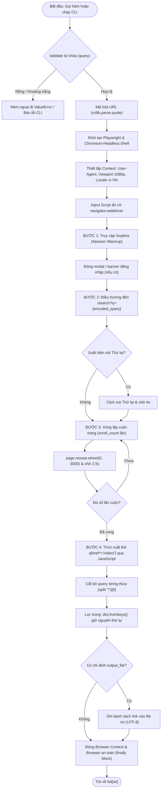

# TÀI LIỆU ĐẶC TẢ KỸ THUẬT: MODULE CRAWL LINK VIDEO TIKTOK (`crawl_tiktok.py`)

---

## 1. Tổng Quan & Mục Tiêu

- **Tên module:** `crawl_tiktok.py`
- **Ngôn ngữ:** Python 3.8+ (khuyến nghị Python 3.10+)
- **Thư viện cốt lõi:** `playwright` (Sync API), `urllib.parse`, `argparse`
- **Engine trình duyệt:** `chromium-headless-shell`
- **Mục tiêu:** Tự động hóa quá trình tìm kiếm trên TikTok theo từ khóa bất kỳ, cuộn trang lấy thêm kết quả và trích xuất danh sách liên kết video (`/video/`) dạng chuẩn, không trùng lặp và làm sạch tham số query thừa.

---

## 2. Kiến Trúc Luồng Hoạt Động (Flowchart)



---

## 3. Đặc Tả Chi Tiết Hàm `crawl_tiktok_links()`

### 3.1. Chữ ký hàm (Function Signature)
```python
def crawl_tiktok_links(
    query: str, 
    scroll_count: int = 3, 
    headless: bool = True,
    output_file: str = None,
    verbose: bool = True
) -> list[str]
```

### 3.2. Bảng tham số đầu vào (Input Parameters)

| Tham số | Kiểu dữ liệu | Mặc định | Bắt buộc | Mô tả chi tiết |
| :--- | :---: | :---: | :---: | :--- |
| **`query`** | `str` | - | **Có** | Chuỗi từ khóa cần tìm kiếm. Hỗ trợ tiếng Việt có dấu, ký tự đặc biệt, khoảng trắng (tự động encode thành URL-safe). Không được để trống. |
| **`scroll_count`** | `int` | `3` | Không | Số lần thực hiện cuộn chuột xuống cuối trang để nạp thêm danh sách video. Mỗi lần cuộn trang cách nhau 2.5 giây. |
| **`headless`** | `bool` | `True` | Không | Chế độ chạy ẩn danh không giao diện (`True`) hoặc hiển thị cửa sổ trình duyệt (`False`). Mặc định sử dụng engine `chromium-headless-shell`. |
| **`output_file`** | `str` | `None` | Không | Đường dẫn file văn bản (`.txt`) để tự động ghi kết quả. Mỗi link một dòng theo chuẩn UTF-8. |
| **`verbose`** | `bool` | `True` | Không | Điều khiển hiển thị log tiến trình ra Terminal (`True`: hiển thị đầy đủ, `False`: chạy yên lặng, phù hợp cho batch test). |

### 3.3. Dữ liệu trả về (Return Value)
- **Kiểu dữ liệu:** `list[str]`
- **Cấu trúc URL:** `https://www.tiktok.com/@<author_id>/video/<video_id>`
- **Đặc điểm:**
  - Không chứa các tham số query dư thừa (đã loại bỏ các tracking parameters như `?is_from_webapp=1&sender_device=pc`).
  - Danh sách đã được lọc loại bỏ các link trùng lặp (duplication-free).
  - Giữ nguyên thứ tự xuất hiện ban đầu theo thuật toán xếp hạng của TikTok.

### 3.4. Ngoại lệ có thể xảy ra (Exceptions)
- **`ValueError`**: Ném ra khi tham số `query` là `None`, rỗng hoặc chỉ toàn khoảng trắng.
- **`playwright._impl._errors.TimeoutError`**: Ném ra khi kết nối mạng quá chậm hoặc trang web không phản hồi vượt ngưỡng `timeout` (30s - 40s).

---

## 4. Đặc Tả Giao Diện Dòng Lệnh (CLI Specification)

Module tích hợp sẵn bộ phân tích dòng lệnh qua `argparse` trong khối `main()`:

### 4.1. Cú pháp câu lệnh
```bash
python crawl_tiktok.py [query] [options]
```

### 4.2. Bảng tùy chọn tham số CLI

| Đối số / Cờ | Kiểu | Mặc định | Mô tả |
| :--- | :---: | :---: | :--- |
| **`query`** *(Positional)* | `str` | `None` | Từ khóa tìm kiếm. Nếu người dùng không nhập, chương trình sẽ hiển thị prompt tương tác: `Nhập từ khóa tìm kiếm TikTok: `. |
| **`-s`, `--scroll`** | `int` | `3` | Số lượt cuộn trang để nạp thêm video. |
| **`--headed`** | `flag` | `False` | Bật cờ này để mở cửa sổ trình duyệt trực quan (mặc định là headless shell). |
| **`-o`, `--output`** | `str` | `None` | Tên hoặc đường dẫn file `.txt` để lưu danh sách kết quả. |

### 4.3. Ví dụ câu lệnh mẫu
```bash
# 1. Tìm kiếm cơ bản (chạy headless ngầm):
python crawl_tiktok.py "ẩm thực đà nẵng"

# 2. Tìm kiếm, cuộn 5 lần và lưu ra file kết quả:
python crawl_tiktok.py "quán cafe view đẹp" --scroll 5 -o cafes.txt

# 3. Mở giao diện trình duyệt để quan sát trực tiếp:
python crawl_tiktok.py "review công nghệ" --headed
```

---

## 5. Đặc Tả Các Giải Pháp Kỹ Thuật Đặc Thù (Anti-Bot & Resilience)

Để khắc phục các cơ chế bảo vệ và chống cào dữ liệu của TikTok, module áp dụng các kỹ thuật sau:

1. **Khởi tạo phiên duyệt web hợp lệ (Session Warmup):**
   - **Vấn đề:** Nếu truy cập trực tiếp ngay vào URL `/search?q=...`, máy chủ TikTok sẽ trả về phản hồi rỗng (`Content-Length: 0`) hoặc lỗi *"Xin lỗi, có vấn đề với máy chủ"*.
   - **Giải pháp:** Trước khi tìm kiếm, script điều hướng vào trang `https://www.tiktok.com/explore` trong 2.5s để TikTok cấp cookie phiên làm việc (`ttwid`, `tt_csrf_token`), sau đó mới chuyển sang trang tìm kiếm.

2. **Sử dụng engine `chromium-headless-shell`:**
   - Phiên bản headless chuyên dụng của Chromium do Playwright cung cấp, tối ưu hóa mức chiếm dụng RAM và CPU thấp hơn ~40% so với Chromium hoàn chỉnh.

3. **Gỡ bỏ dấu vết công cụ tự động hóa:**
   - Thêm tham số trình duyệt: `--disable-blink-features=AutomationControlled`.
   - Tiêm script khởi tạo DOM (`add_init_script`):
     ```javascript
     Object.defineProperty(navigator, 'webdriver', { get: () => undefined });
     ```

4. **Chuẩn hóa Client Profile:**
   - Cung cấp chuỗi `User-Agent` của trình duyệt Chrome máy tính thật trên Windows 10/11.
   - Thiết lập `viewport` chuẩn Full HD (`1920x1080`) và `locale: "vi-VN"`.

5. **Xử lý các tình huống giao diện phát sinh:**
   - Tự động đóng banner gợi ý đăng nhập (`modal-close-inner-button`).
   - Tự động phát hiện và click nút **Thử lại** (`Try again` / `Thử lại` / `もう一度お試しください`) nếu gặp chập chờn mạng.
   - Đảm bảo đóng trình duyệt và context an toàn trong khối `finally`.

---

## 6. Ràng Buộc & Khuyến Nghị Vận Hành

- **Giới hạn tần suất (Rate Limiting) của TikTok:**
  - Máy chủ TikTok giám sát rất chặt lưu lượng tìm kiếm từ mỗi địa chỉ IP.
  - **Khi cào đơn lẻ:** Hoạt động ổn định bình thường.
  - **Khi cào hàng loạt (Batch crawling nhiều từ khóa):** Bắt buộc phải duy trì độ trễ giữa các từ khóa (tối thiểu **5 đến 10 giây**). Tuyệt đối không gửi liên tục không nghỉ (`delay = 0`) để tránh bị máy chủ TikTok kích hoạt tạm khóa tìm kiếm theo IP.

